# Week 6：Energy-based models

课程讲义：[week6-learning-sheet.pdf](week6-learning-sheet.pdf)。
来源：https://giggleliu.github.io/AMAT5315-2026Fall/pdfs/week6-learning-sheet.pdf

## 环境

以下命令从 `week6/` 执行，使用 uv 和 Python 3.12，默认在 CPU 上运行：

```sh
uv sync --locked
export JAX_PLATFORMS=cpu
uv run python -c 'import jax; print(jax.devices())'
```

如果当前机器的 uv 不在 PATH 中，本仓库已有的
`../week5/.bootstrap/bin/uv` 可代替上述 `uv` 命令。

## 文件约定

- `scripts/`：运行、比较和绘图脚本。
- `evidence/`：需要提交的图及验收证据。
- `inputs/`：下载的数据，不进入 Git。
- `artifacts/`：原始运行结果及对应设置，不进入 Git。
- `uv.lock`：锁定依赖版本；`.venv/` 不进入 Git。

每个任务完成后单独提交。实验存在不明确要求时先询问。
完成实验后在本文件逐项记录证据图、生成命令、数据来源及运行设置。

## 当前状态

全部四个必做部分及最终核验已完成；16张证据图、复现命令和中文解释见下文。可选 AIS/NLL 扩展未做。

## Part 1：数据集（已验证）

运行：`uv run --locked python scripts/data.py`。


MNIST 原始训练集 60,000 张、测试集 10,000 张；每张是 28×28 的 uint8 灰度图，像素范围 0–255。
各类前三张训练图片保留存储顺序，可见笔画粗细、倾斜和写法的变化。数字 1 在两个划分中最多，5 最少。


CIFAR-10 原始训练集 50,000 张、测试集 10,000 张；每张是 32×32×3 的 uint8 RGB 图。
二进制记录按标签、R 平面、G 平面、B 平面读取，再转为 HWC。每类训练 5,000 张、测试 1,000 张，比例均为 0.1。
低分辨率保留大致轮廓、颜色与背景，动物面部、纹理等细节难以分辨。图库每类取相同数量，说明内容而不反映频率；频率图使用全部标签。
所有图像均使用 nearest 插值，不平滑或补造细节。校验记录见 [datasets.json](evidence/datasets.json)，包括全部计数及 SHA-256。

数据来源（讲义指定下载版本，原始文件保存在 `inputs/`）：

- https://storage.googleapis.com/cvdf-datasets/mnist/train-images-idx3-ubyte.gz
- https://storage.googleapis.com/cvdf-datasets/mnist/train-labels-idx1-ubyte.gz
- https://storage.googleapis.com/cvdf-datasets/mnist/t10k-images-idx3-ubyte.gz
- https://storage.googleapis.com/cvdf-datasets/mnist/t10k-labels-idx1-ubyte.gz
- https://mindspore-website.obs.cn-north-4.myhuaweicloud.com/notebook/datasets/cifar-10-binary.tar.gz

MNIST 是手写数字数据；CIFAR-10 是十类物体照片数据。这里按讲义使用 CVDF 和华为云镜像；下载地址和文件哈希共同标识实际使用的文件。

## Part 2：RBM（已验证）

完整运行：`JAX_PLATFORMS=cpu uv run --locked python scripts/rbm.py all`。
仅重做采样与绘图：`JAX_PLATFORMS=cpu uv run --locked python scripts/rbm.py evaluate`，需要本地保存的两个 epoch20 检查点。
单独训练使用 `train`。下列所有 Part 2 图由 `all` 生成。

二值化规则为像素 ≥128 时 v=1，否则 v=0；自旋 s=2v−1，白色墨迹为 +1、黑色背景为 −1。

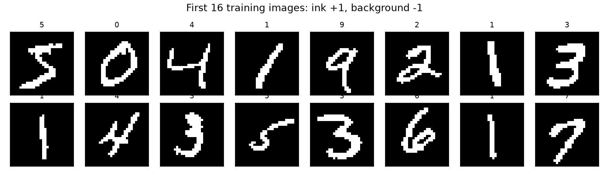

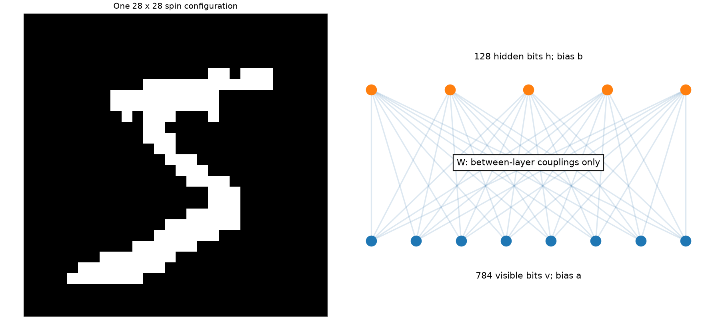

模型有 784 个可见位和 128 个隐藏位。图中仅画部分节点，所有 W 都跨层连接，没有层内耦合。
能量 `E(v,h)=-aᵀv-bᵀh-vᵀWh`；对隐藏位求和后，
`F(v)=-aᵀv-Σⱼ softplus(bⱼ+(vᵀW)ⱼ)`。
条件分布分别为 `p(h=1|v)=sigmoid(vW+b)` 和 `p(v=1|h)=sigmoid(hWᵀ+a)`；一个 Gibbs 步包含两次实际 Bernoulli 抽样。

训练严格使用 [rbm.toml](rbm.toml)：全部 60,000 张、20 epochs、batch=100、float32、SGD 学习率 0.1、无 momentum/weight decay。
初始化权重标准差 0.01，隐藏偏置 0，可见偏置为训练像素频率 clip 到 [0.01,0.99] 后的 logit。
初始化种子 6601，训练/打乱种子 6602，评估种子 6606。CD-1、CD-10 从同一参数出发，每 epoch 数据顺序相同（SHA-256 已比对）。
每次训练更新求 `mean(F(v0)-F(stop_gradient(vk)))` 的参数梯度；负相用从训练图起步的 k 步端点代替模型平衡分布，因而近似似然梯度。

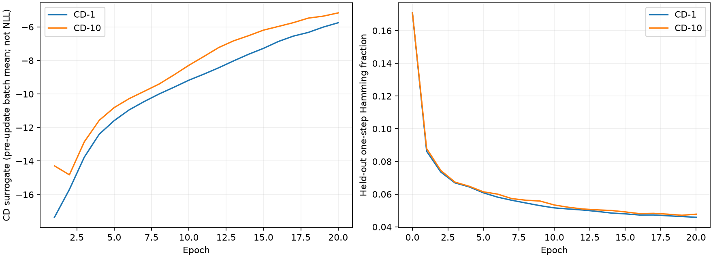

| 模型 | 初始重构 Hamming | 第20 epoch | CPU训练秒数 |
|---|---:|---:|---:|
| CD-1 | 0.17084 | 0.04588 | 9.56 |
| CD-10 | 0.17084 | 0.04777 | 48.20 |

误差使用存储顺序中前 64 张测试图、固定 Gibbs 随机数及抽样后的二值像素，两个结果均低于初始值的一半。
CD surrogate 是更新前各 batch 的均值，本次整体趋向较不负的数值；它不是 NLL，也不必下降。
NLL 还包含随参数变化的 `log Z`，不能省略后称为似然曲线。一步重构保留了输入信息，既不能证明良好的从零生成，也不能证明 NLL 降低。
详细曲线和参数见 [rbm_training.json](evidence/rbm_training.json)。

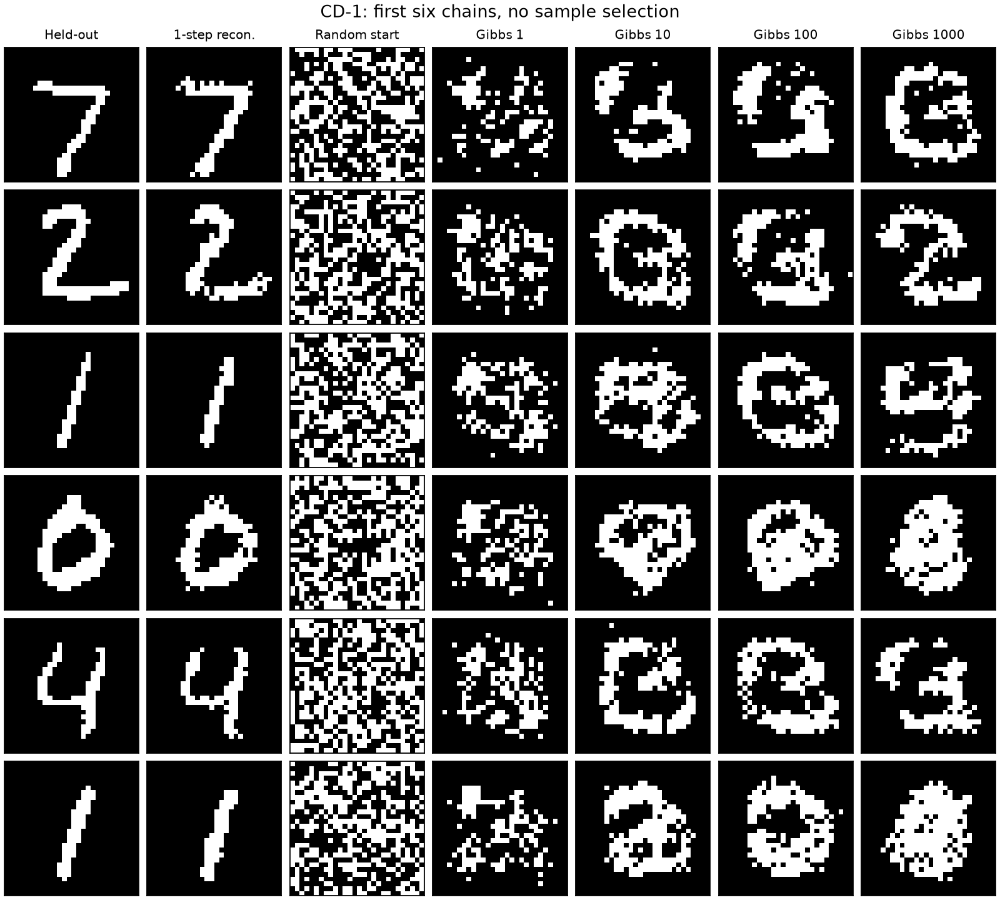

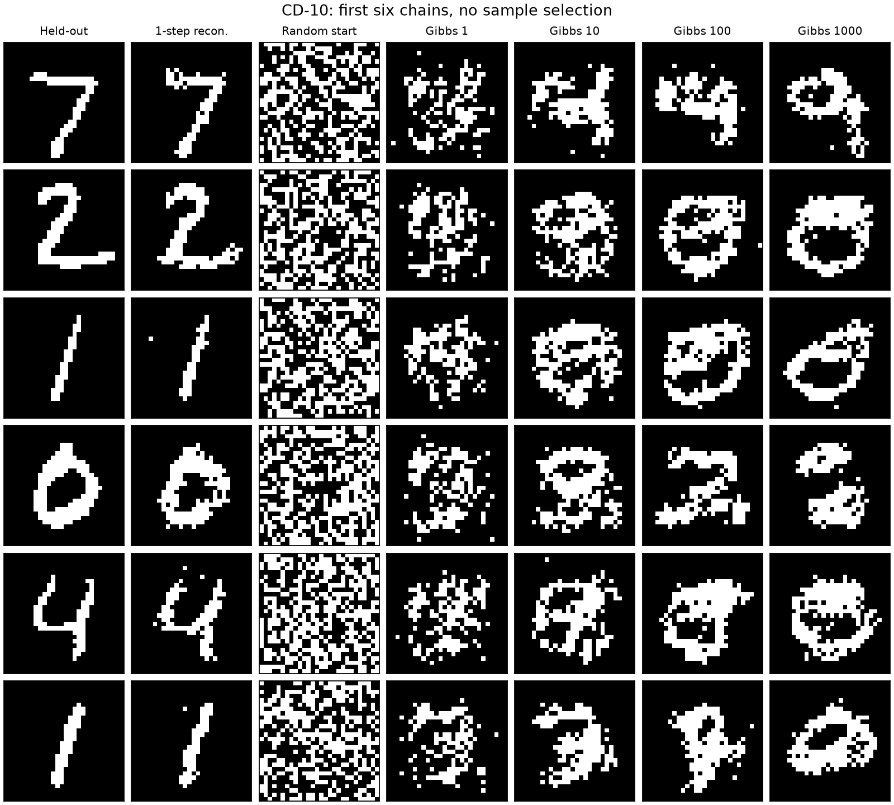

两模型冻结参数，从相同 64 组公平随机二值配置开始；起点种子 6605，生成 Gibbs 流种子 6705。
保存 0、1、10、100、1000 步，图中固定展示前六条链，不挑选结果。一步重构通常能看出原来的数字；生成则由散点逐渐形成块、环和笔画。
1000 步仍常有变形图形和重复的环，CD-10 也没有普遍变成清晰数字。两模型的链表现各有差异，不能依据个别图像宣称 CD-10 的生成一定更好。
增加训练 k 改变的是梯度近似；增加生成长度改变的是固定模型的链演化。更长采样不能修复学错的分布，形成结构也不等于充分混合。

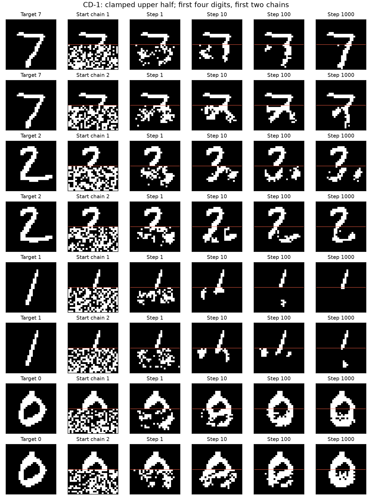

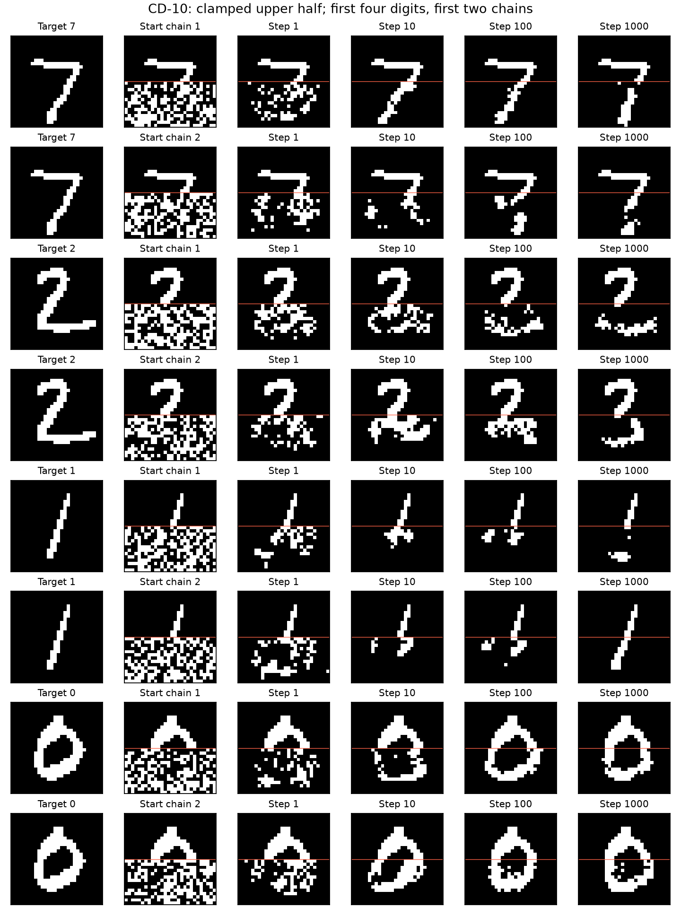

补全取前 64 张测试图，每图每模型 8 条链、种子 6607，保存同样的采样步数。上方 14 行逐步钳制不变；下半图使用相同随机起点。
错误上半图取这 64 张中向后循环遇到的第一张不同标签图片；两种条件都与原目标的真实下半图比较。
图中每个模型展示前四张图的前两条链：7 能续出向下的笔画，2 出现不同的弯曲补全，0 能形成环；1 的下半图仍可能空白，CD-10 也并非每条链都成功。

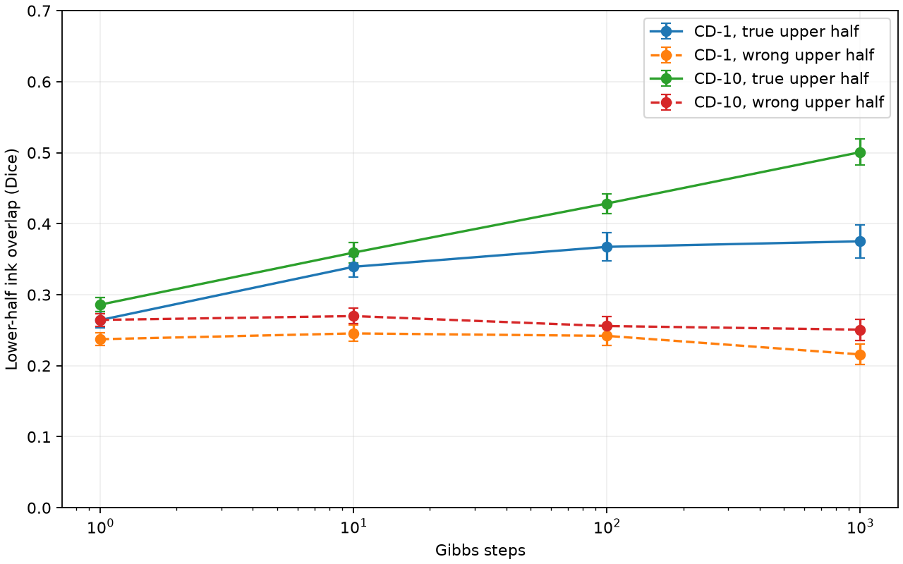

| 模型 | 1000步正确上半图 Dice ± SE | 错误上半图 Dice ± SE | 优势（要求≥0.1） |
|---|---:|---:|---:|
| CD-1 | 0.3752 ± 0.0236 | 0.2159 ± 0.0145 | 0.1593 |
| CD-10 | 0.5007 ± 0.0184 | 0.2508 ± 0.0149 | 0.2499 |

Dice 为 `2|A∩B|/(|A|+|B|)`，只计算缺失下半图。每图先平均8条链，再对64张图计算标准误，避免把同一图的链当成独立数字。
正确条件的平均 Dice 随步数增加；错误条件没有这种增长。错误条件非零是因为不同数字的中央笔画仍会重叠。
CD-10 的补全明显优于 CD-1，尽管一步重构误差接近。钳制把无条件生成变为对 `p(v_missing|v_observed)` 的条件推断；这不需要重新训练。
统计与错误图索引见 [rbm_evaluation.json](evidence/rbm_evaluation.json)。

验证命令：`JAX_PLATFORMS=cpu uv run --locked python -m unittest discover -s scripts -p test_rbm.py -v`。
4项测试通过：小模型枚举隐藏态验证自由能、NumPy 相关性公式验证 CD 梯度及 stop-gradient、抽样边缘概率检查、完整实验的重构/钳制/配对起点/补全验收。

## Part 3：随机模式的经典 Hopfield 网络（已验证）

运行及两张证据图的生成命令：`JAX_PLATFORMS=cpu uv run --locked python scripts/hopfield.py`。

完整预算为 N=100,200,400,800，α=0.05 至0.25（步长0.01），每点20个独立模式集合，共1,680组；每组从前10个存储模式出发，P<10时使用全部模式。
自旋是独立公平 ±1，`J=ΞᵀΞ/N` 且 `J_ii=0`。实际计算保存整数矩阵 `N*J`，它保持零温场的符号和零点，避免浮点舍入引起零场假翻转。
每个 sweep 使用随机顺序逐个异步更新；场为零时保持原自旋，直到整轮没有翻转才停止，没有提前截断。
一次翻转的能量变化是 `ΔE=2s_i h_i<0`；能量也等于 `-N/2 Σμ mμ²+P/2`。代码的能量函数包含除以 N 的归一化。

模式种子由 `SeedSequence([6630,N,load_index,set_index])` 生成；更新顺序使用 JAX key 6630 依次 fold_in 相同坐标，再拆分各查询的 key。
原始模式、最终状态、每次 recall 的 overlap 和 sweep 数均保存在 `artifacts/hopfield_N*_P*.npz`，摘要见 [hopfield.json](evidence/hopfield.json)。
本机整个扫描约149.55秒（含首次编译与写文件）；每条误差棒是20组独立模式集合之间的标准误。

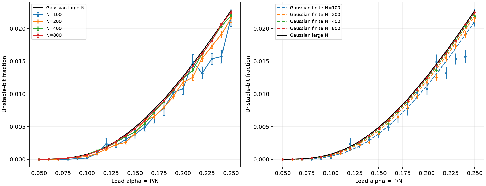

在存储模式上，稳定性场由自信号 `(N−1)/N` 和其余模式串扰组成。串扰近似零均值高斯，方差为 `(P−1)(N−1)/N²`，故不稳定概率约为
`Φ(-sqrt((N−1)/(P−1)))`，大 N 时趋于 `Φ(-1/sqrt(α))`。这里统计严格的 `ξ_i h_i<0`，零场不计为不稳定。
N=800、α=0.20 时测得0.01243，接近大 N 预测0.01267。N=100、α=0.10 时测得0.00020，低于大 N 预测0.000783；有限 N 高斯预测约0.000456。
有限样本波动、离散场的零点及高斯近似误差都存在，不能要求每点等于理论曲线。右图同时画出有限 N 预测，以区分有限尺寸修正。

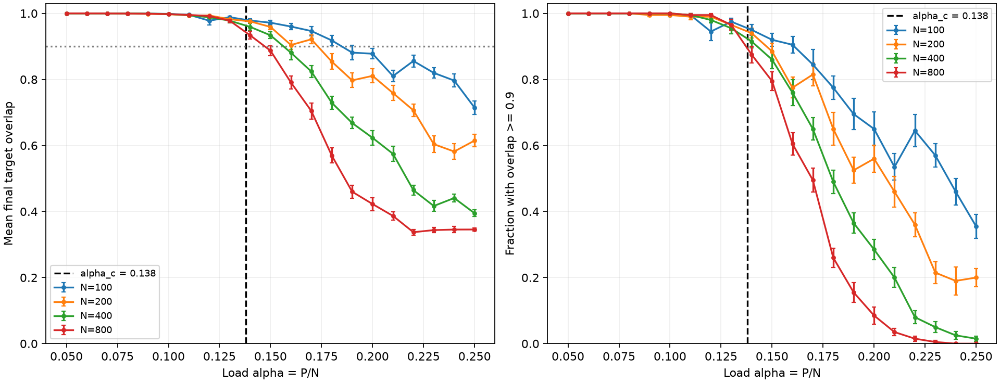

| N | 平均 overlap 首次跌破0.9的线性插值交叉点 | 讲义参考 |
|---:|---:|---:|
| 100 | 0.18491 | 0.186 |
| 200 | 0.17319 | 0.170 |
| 400 | 0.15636 | 0.156 |
| 800 | 0.14720 | 0.150 |

四个交叉点随 N 严格下降，均在参考值 ±0.02 内。α 较小时召回接近完整；超过转变区后，不稳定自旋的翻转改变其他局部场，进一步触发翻转，最终进入远离目标的局部极小值。
有限 N 的跌落平滑，N 增大时转变变陡并向理论极限 α_c≈0.138 靠近；0.138 是大 N 极限，并非每个有限系统都在此处突然失败。
α=0.25、N=800 时平均 overlap 约0.346，overlap≥0.9 的成功比例为0。

验证：`JAX_PLATFORMS=cpu uv run --locked python -m unittest discover -s scripts -p test_hopfield.py -v`。
4项测试检查 Hebbian 耦合/能量恒等式、与独立 NumPy 异步轨迹逐项一致且每次翻转降能、零场保留自旋、完整预算与交叉点。
完整运行还检查每个最终状态都没有可下降能量的单自旋翻转。

## Part 4：现代 Hopfield 与 attention（已验证）

运行及本节四张图的生成命令：`JAX_PLATFORMS=cpu uv run --locked python scripts/modern.py`。

按原存储顺序取前 P 张 MNIST 训练图片，二值化为 ±1；P=3,10,30,100,300,1000。
每个 P 查询100次，目标索引为 `arange(100)%P`；仅把下半图替换为公平随机自旋，种子6640。
同一 P 的经典召回和全部 β 使用完全相同的查询，现代召回只更新一步，不钳制或反复迭代。
β=0.001,0.003,0.01,0.03,0.1,0.3,1。经典召回沿用 Part 3 的异步零温更新、零对角线和无翻转终止条件。

把图像按列排成 X，现代更新是 `x_new=X softmax(β Xᵀx)`。
代码按行存储模式，因此批量形式为 `softmax(β Q X) Xᵀ`。
JAX attention 使用 query=x、key=value=存储模式，并显式设 `scale=beta`，不使用默认 `1/sqrt(784)`。
对应现代能量为 `E(x)=-(1/β)logsumexp(β Xᵀx)+xᵀx/2+const`；完整网格的每次现代更新均检查能量不增。

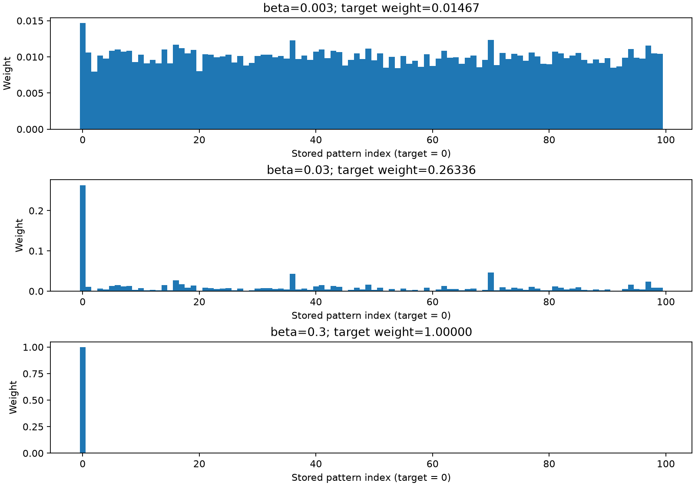

P=100、第一个查询在 β=0.003,0.03,0.3 时，目标模式权重分别约0.01467、0.26336、1.00000。
整个实验网格中，直接现代更新与 JAX attention 输出的最大绝对差为 **0.0**（float32，同一后端的运算结果恰好一致），小于要求的10⁻⁵。
另用独立 float64 NumPy softmax 与矩阵乘法验证全部输出；允许10⁻⁵的 float32 累加误差，避免把同一 JAX 运算路径的相等当成唯一验证。

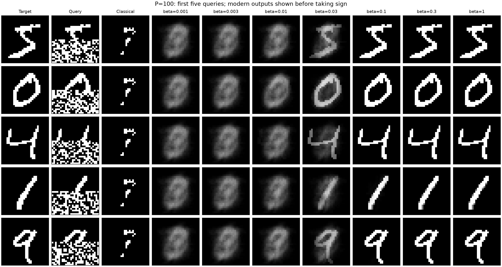

图中展示 P=100 的前五个查询。小 β 的权重接近均匀，输出是类似的模糊平均数字；β=0.03 开始显露目标形状，β≥0.1 的这些示例已很接近存储目标。
保留取 sign 前的实数结果，因而可以看到模糊平均，而不是只看阈值化图片。经典召回在这些查询下都返回相同的稀疏笔画片段。

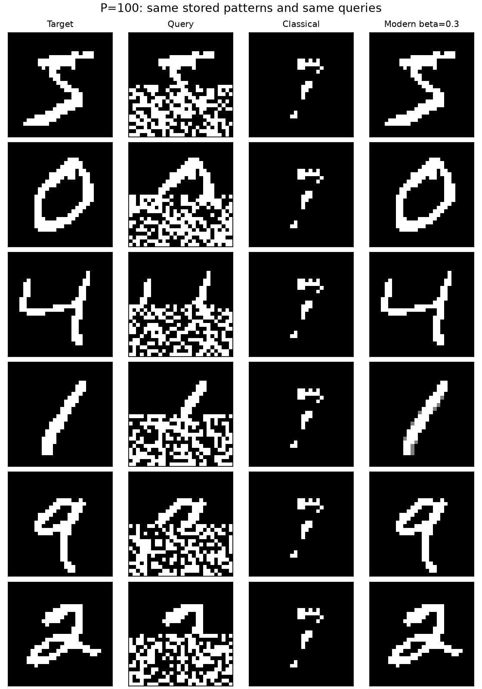

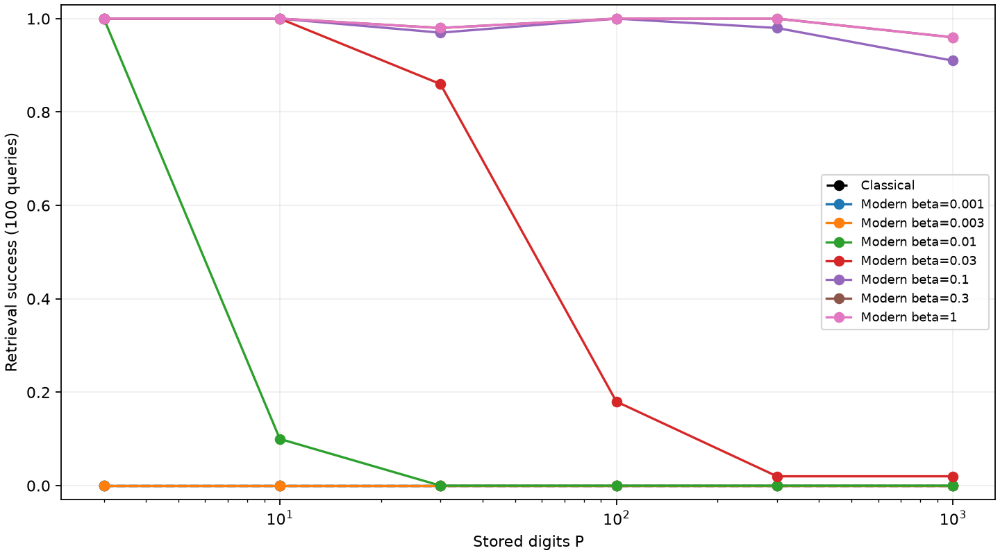

成功需要同时满足：输出取符号后与目标 overlap≥0.95，且目标是所有存储模式中最近的一个。
零输出取 +1；若目标与其他模式并列最近，视为最近之一，另存并列数量。重叠阈值相当于784像素中至多19个错误。

| P | 经典成功率 | 现代 β=0.1 | 现代 β=0.3 |
|---:|---:|---:|---:|
| 3 | 0% | 100% | 100% |
| 10 | 0% | 100% | 100% |
| 30 | 0% | 97% | 98% |
| 100 | 0% | 100% | 100% |
| 300 | 0% | 98% | 100% |
| 1000 | 0% | 91% | 96% |

β=0.3 在所有 P 上均达到要求的≥90%；经典成功率全部为0。随着 P 增加，部分上半图和随机下半图会使另一个存储数字更相似，增大 β 也未必改正这种目标识别歧义。
P 很小时，小 β 也可能已足以区分目标，例如 P=3、β=0.01 在本次达到100%；温度效果还取决于候选数量和相似度间隔。

MNIST 背景和笔画高度相关，不能套用 Part 3 的独立随机模式容量结论。P=100 时未损坏的存储图已有约11.75%的不稳定位。
即使 P=3、α≈0.00383，经典召回也失败；共同背景形成强的偏向，驱动系统走向类似多数像素的公共状态。
现代机制则用整张查询对模式的相似度产生 softmax 权重，较大 β 选择单个模式；这是 attention 的查询、键和值运算。
Hopfield 此处取回的是存储过的图片，不能把它与 RBM 对未见测试图的补全泛化混为一谈。
完整参数、各 β 成功率与一致性统计见 [modern.json](evidence/modern.json)，该网格本机计算约6.47秒（不含最后绘图）。

验证：`JAX_PLATFORMS=cpu uv run --locked python -m unittest discover -s scripts -p test_modern.py -v`。
3项测试验证独立 NumPy attention/能量、成功判据确实包含最近目标限制、全部实验网格与讲义验收标准。

## 最终核验与复现

未知目标分布 `p_data` 表示真实世界中数字/物体图像的概率规律，我们只能通过有限样本认识它。
Part 1 的经验分布给每条下载记录相同权重1/N，标签频率是这份有限数据的统计，不是未知总体概率本身。
Part 2 的拟合模型 `p_theta(v)=exp(-F_theta(v))/Z_theta` 是参数化概率分布，既不等同于数据列表，也不会因好的一步重构就自动等于目标分布。
Gibbs 是从给定模型取样的算法；步数、起点和混合决定有限轨迹离平衡分布有多远。图中的重构、从零生成与钳制补全分别使用完整输入、无观测和部分观测，因此检验不同能力。
CD 在似然梯度的负相近似平衡期望；钳制上半图使同一采样机制改为条件推断。Part 3 的串扰图解释随机存储为何出现容量极限；Part 4 的权重和成功率图验证 softmax attention 如何由平均切换为模式检索。

一次完整复现（均在 `week6/` 下）：

```sh
uv sync --locked
export JAX_PLATFORMS=cpu
uv run --locked python scripts/data.py
uv run --locked python scripts/rbm.py all
uv run --locked python scripts/hopfield.py
uv run --locked python scripts/modern.py
uv run --locked python scripts/verify.py
```

最后一条命令执行全部11项测试并生成 [verification.json](evidence/verification.json)，记录环境版本、CPU后端、验收数值与16张证据图的清单。
环境由 Python 3.12 和 `uv.lock` 锁定。本次运行版本以核验文件为准；随机种子和数组精度已固定，但不同硬件/库版本的随机轨迹和浮点舍入仍可能略有差异。
全部 raw 数组、逐 epoch 检查点与完整日志位于 `artifacts/`，数据下载在 `inputs/`；二者及 `.venv/` 均被 Git 排除。
提交内容包括源码、环境锁文件、讲义、中文解释与 `evidence/` 图和精简核验摘要。

已完成所有非 bonus 部分；可选 AIS/NLL 扩展未做。Week 7 可直接使用本 README 和证据图展示；讲义说明本周无需另行提交作业。
