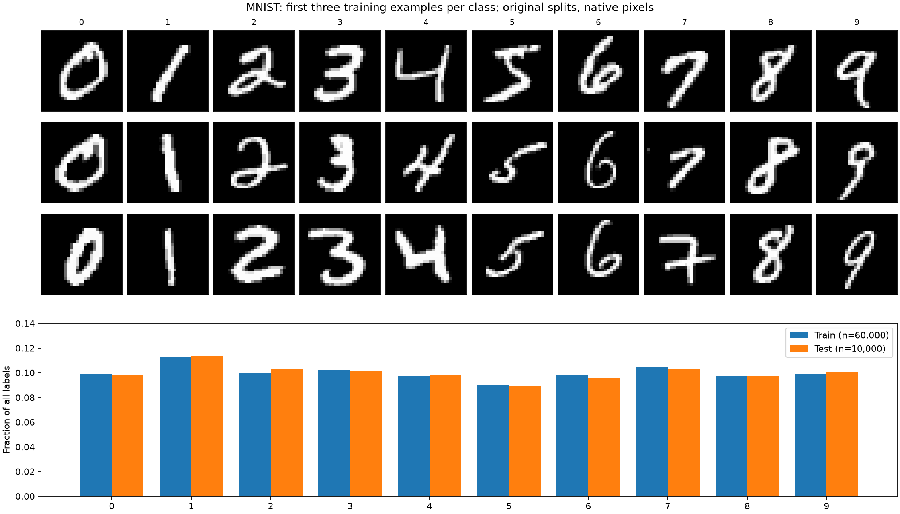
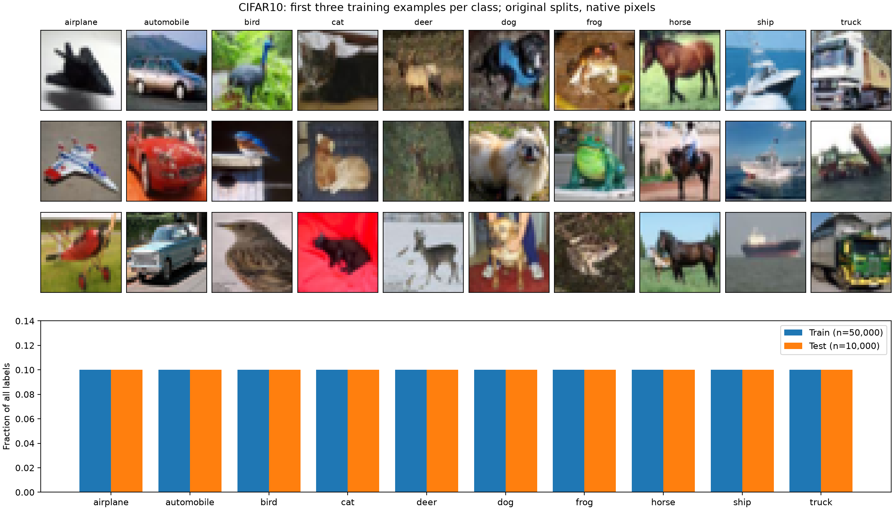

# Week 6：Energy-based models

课程讲义：[week6-learning-sheet.pdf](week6-learning-sheet.pdf)。
来源：https://giggleliu.github.io/AMAT5315-2026Fall/pdfs/week6-learning-sheet.pdf

## 环境

以下命令从 `week6/` 执行，使用 uv 和 Python 3.12，默认在 CPU 上运行：

```sh
uv sync --locked
export JAX_PLATFORMS=cpu
uv run python -c 'import jax; print(jax.devices())'
```

如果当前机器的 uv 不在 PATH 中，本仓库已有的
`../week5/.bootstrap/bin/uv` 可代替上述 `uv` 命令。

## 文件约定

- `scripts/`：运行、比较和绘图脚本。
- `evidence/`：需要提交的图及验收证据。
- `inputs/`：下载的数据，不进入 Git。
- `artifacts/`：原始运行结果及对应设置，不进入 Git。
- `uv.lock`：锁定依赖版本；`.venv/` 不进入 Git。

每个任务完成后单独提交。实验存在不明确要求时先询问。
完成实验后在本文件逐项记录证据图、生成命令、数据来源及运行设置。

## 当前状态

已下载讲义并建立项目目录；尚未开始数据集分析或模型实验。

## Part 1：数据集（已验证）

运行：`uv run --locked python scripts/data.py`。



MNIST 原始训练集 60,000 张、测试集 10,000 张；每张是 28×28 的 uint8 灰度图，像素范围 0–255。
各类前三张训练图片保留存储顺序，可见笔画粗细、倾斜和写法的变化。数字 1 在两个划分中最多，5 最少。



CIFAR-10 原始训练集 50,000 张、测试集 10,000 张；每张是 32×32×3 的 uint8 RGB 图。
二进制记录按标签、R 平面、G 平面、B 平面读取，再转为 HWC。每类训练 5,000 张、测试 1,000 张，比例均为 0.1。
低分辨率保留大致轮廓、颜色与背景，动物面部、纹理等细节难以分辨。图库每类取相同数量，说明内容而不反映频率；频率图使用全部标签。
所有图像均使用 nearest 插值，不平滑或补造细节。校验记录见 [datasets.json](evidence/datasets.json)，包括全部计数及 SHA-256。

数据来源（讲义指定下载版本，原始文件保存在 `inputs/`）：

- https://storage.googleapis.com/cvdf-datasets/mnist/train-images-idx3-ubyte.gz
- https://storage.googleapis.com/cvdf-datasets/mnist/train-labels-idx1-ubyte.gz
- https://storage.googleapis.com/cvdf-datasets/mnist/t10k-images-idx3-ubyte.gz
- https://storage.googleapis.com/cvdf-datasets/mnist/t10k-labels-idx1-ubyte.gz
- https://mindspore-website.obs.cn-north-4.myhuaweicloud.com/notebook/datasets/cifar-10-binary.tar.gz

MNIST 是手写数字数据；CIFAR-10 是十类物体照片数据。这里按讲义使用 CVDF 和华为云镜像；下载地址和文件哈希共同标识实际使用的文件。
