# Week 7：Diffusion and flow matching

讲义：[week7-learning-sheet.pdf](week7-learning-sheet.pdf)，下载自
https://giggleliu.github.io/AMAT5315-2026Fall/pdfs/week7-learning-sheet.pdf 。
原文提取保存在 `week7-learning-sheet.txt`，未改动题目规格。

全部命令从 `week7/` 执行。环境：Python 3.12、uv、CPU、float32。

```sh
../week5/.bootstrap/bin/uv sync --locked
export JAX_PLATFORMS=cpu
export MPLCONFIGDIR=artifacts/mpl
```

系统已安装 uv 时可直接使用 `uv`。`inputs/` 是下载，`artifacts/` 是原始数组、模型检查点、训练曲线和日志；两者及 `.venv/` 均不进 Git。

## Part 1：DDPM

```sh
uv run --locked python scripts/mixture.py train-noise
uv run --locked python scripts/mixture.py part1
uv run --locked python -m unittest discover -s scripts -p test_transport.py -k test_part1 -v
```

前两条命令生成本节全部证据。

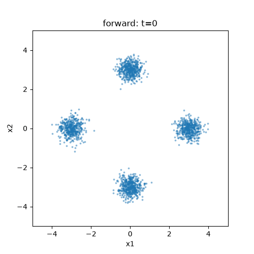
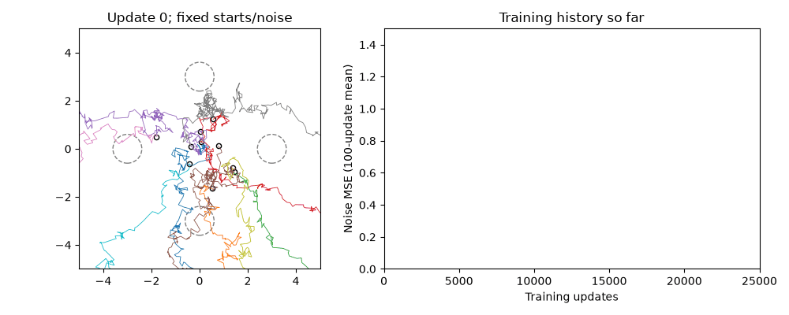
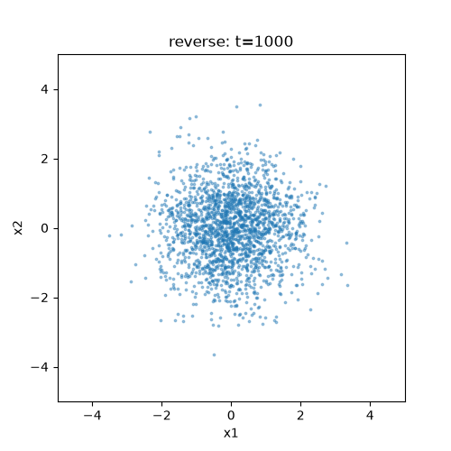
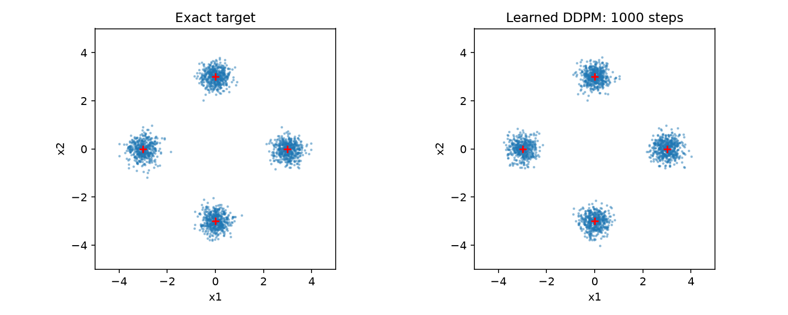
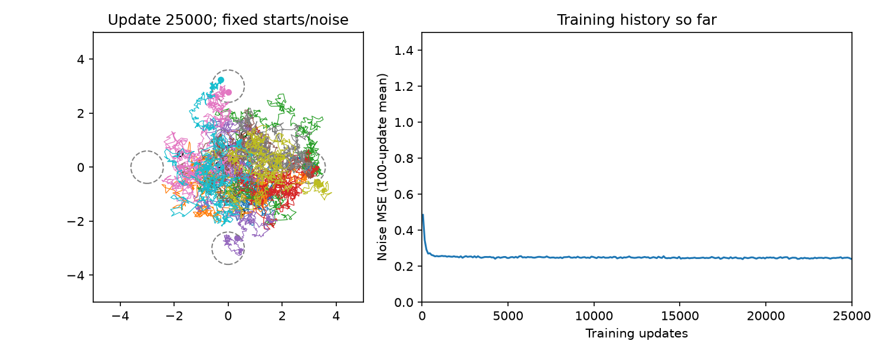

四个中心是 (3,0)、(0,3)、(-3,0)、(0,-3)，等权且协方差 0.09I。
使用 1000 步线性 β∈[0.0001,0.02]，DDPM 方差 β，最终步不加噪，全程不裁剪。
前向动画跟踪同一批 2000 个点逐步加噪，并保持坐标尺度；t=1000 的均值为 (0.0186,0.0107)，方差为 (1.0119,0.9828)。

网络为 34→128→128→128→2，三个 SiLU 隐藏层；输入拼接两个坐标与16对正弦/余弦时间特征。
每次用512个新混合样本，t在1至1000均匀抽样，最小化每坐标噪声 MSE。
Adam 初始学习率0.001，25000次更新，最后一次学习率为0。初始化种子7101；训练随机流7201。
保存0、100、250、500、1000、2500、5000、10000、17500、25000更新的10个阶段。
详见 [noise_training.json](evidence/noise_training.json)。

训练动画中每阶段固定权重，重复同一10个高斯起点和全部反向噪声；阶段之间只改变权重。
初始轨迹最大坐标绝对值约3351，超出固定显示范围；最终端点围绕目标簇。
最后1000次平均损失0.2463。最优回归给出 E[ε|x_t,t]，无法知道一次加噪的真实ε，因此条件方差使损失不必为0。

生成2000个点，簇比例为0.2685、0.2530、0.2330、0.2455；最大中心欧氏偏差0.02215，最大宽度误差0.01207。
比例、中心、宽度三个验收均通过。全部中心与逐坐标标准差见 [part1.json](evidence/part1.json)。
只检查散点图或比例并不足够：正确比例也可能掩盖中心偏移或簇宽度错误。

## Part 2：DDIM

命令：`uv run --locked python scripts/mixture.py part2`。

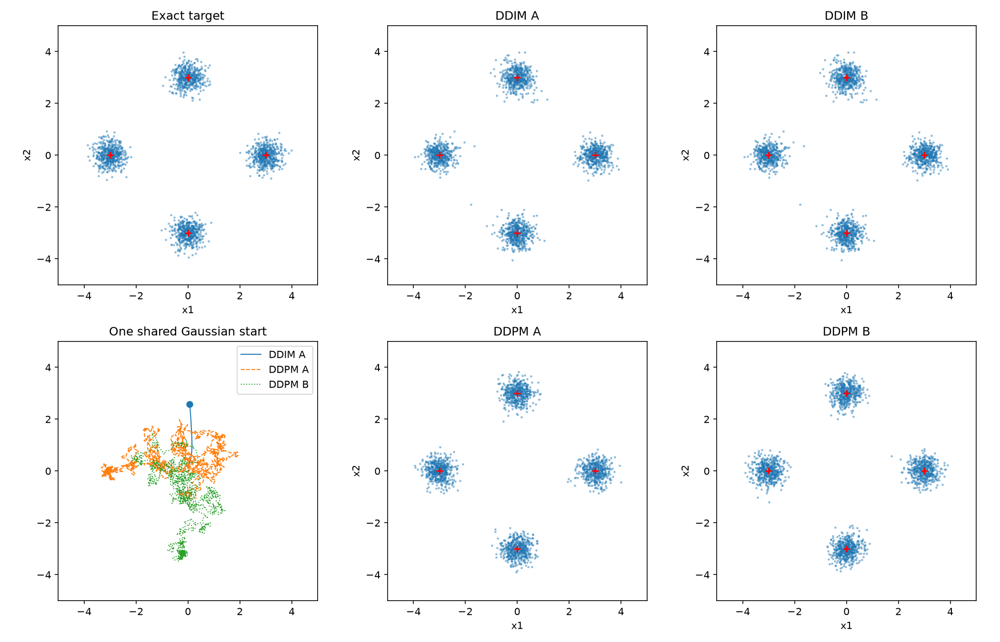

DDIM 使用 x̂₀=(xₜ−√(1−ᾱₜ)ε̂)/√ᾱₜ，再构造 xₜ′=√ᾱₜ′x̂₀+√(1−ᾱₜ′)ε̂。
它改变了更新系数，不能只删掉 DDPM 的随机项。`sample(...,method='ddim',steps=...,analytic=True)` 可切换为解析条件平均噪声。
对每个分量，带噪均值为√ᾱₜ μₖ，方差为 V=0.09ᾱₜ+1−ᾱₜ；后验权重按该分量在 xₜ 的密度归一化。
解析 ε 是 √(1−ᾱₜ)/V 乘以后验加权的 (xₜ−√ᾱₜ μₖ)。

使用与 Part 1 相同的2000个初始高斯点，各运行1000步。DDIM A/B 的逐元素最大差为 **0**。
DDPM A/B 使用独立反向随机流，最终落入同一簇的比例为 **0.2435**，接近独立四簇的1/4。
图左下展示同一起点的三条轨迹，其余各面板均为2000个点。

DDIM 簇比例最大偏差0.0145，小于0.015；中心最大欧氏偏差0.02365。
**参考范围差异：**讲义给出的宽度范围是0.29–0.32；本次 DDIM 为0.27793–0.31634，两个坐标低于该范围，不能声称完全复现这条参考结果。
DDPM A/B 分别为0.29047–0.31462和0.29136–0.31110。
DDIM 最大宽度误差0.02207，仍在 Part 1 的±0.03容差内；这是单独报告的较宽判据，不替代原参考范围。
同一初始点用解析预测器得到0.28457–0.30536，说明小样本也会产生偏差；学习误差还可能进一步改变宽度。
没有筛选种子或删除结果。完整统计及 `reference_width_range_matched=false` 见 [part2.json](evidence/part2.json)。

## Part 3：Flow matching 与步数成本

```sh
uv run --locked python scripts/mixture.py train-flow
uv run --locked python scripts/mixture.py part3
```

第二条命令生成下列两图。

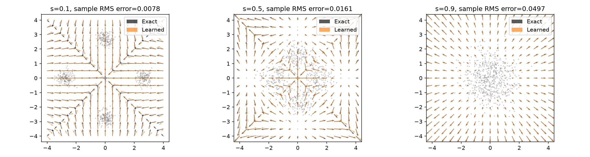
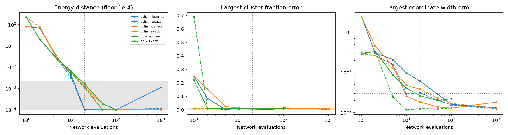

使用与噪声网络相同的架构，从新种子7102初始化，独立训练25000次；其余优化设置相同。
训练输入 xₛ=(1−s)x₀+sz，s均匀于[0,1)，目标 z−x₀；按512个新样本的逐坐标 MSE 回归。
训练曲线与设置分别保存为 `artifacts/flow_training.npz` 和 [flow_training.json](evidence/flow_training.json)。
从 s=1 向0做 Euler 更新 x←x−Δs vθ(x,s)，不是顺着图中箭头走。

分量在 s 时的均值为 (1−s)μₖ，方差 Vₛ=0.09(1−s)²+s²。
其条件速度为 −μₖ+[s−0.09(1−s)]/Vₛ·[x−(1−s)μₖ]，再用分量后验概率加权。
这种平均保持了构造路径的概率通量，因此精确边缘速度场能输运相同的概率分布。
数值步长和网络近似仍然可能带来误差。

箭头绘在[-4,4]²的17×17网格，背景为对应边缘分布的样本；长箭头截短仅用于显示。
相对 RMS 在每个 s 的10000个独立边缘测试样本上计算，先平方再求和，未用显示裁剪后的箭头计算。
s=0.1、0.5、0.9 时分别为 **0.00778、0.01606、0.04974**，均小于0.1。
低密度远场网格上的外推不受训练样本充分约束，图中某些箭头仍可有差异。
s→1 时精确速度趋于x，反向生成则开始从高斯分布收缩。

比较使用固定4000个高斯起点和独立4000个精确目标样本；步数1、2、5、10、20、50、100，DDPM/DDIM再加1000。
扩散层级为均匀整数网格；跳步DDPM用 a=ᾱₜ/ᾱₜ′，方差1−a，末步不加噪。
实线使用学习网络，虚线使用解析预测；所有分量中心、比例、宽度及能量距离保存在 [part3.json](evidence/part3.json)。
每种设置的4000个端点保存于 `artifacts/part3.npz`。

能量距离估计为 2 mean‖X−Y‖ − mean‖X−X′‖ − mean‖Y−Y′‖，两个同分布项排除对角线。
独立抽取20对各4000点的精确样本估计 null；95%分位数为 **0.002091**。
无偏有限样本估计可能为负；JSON保留原值，绘图将小于10⁻⁴的值画在10⁻⁴。
比例阴影为单个簇的±2√(0.25×0.75/4000)，不是四个簇最大误差的同时置信带。

| 学习采样器 | 步数 | 能量距离 | 最大宽度误差 |
|---|---:|---:|---:|
| DDPM | 20 | -0.000214 | 0.06054 |
| DDPM | 50 | -0.000123 | 0.02813 |
| DDIM | 20 | 0.001125 | 0.01809 |
| Flow | 20 | 0.001622 | 0.02617 |

Flow在20步满足D<0.005且宽度误差<0.03。DDIM也只需要几十步，本次20步两项数值甚至略优于Flow；不能宣称Flow一定更好。
DDPM虽然20步的能量距离落在null尺度内，但宽度明显过大，需要约50步才达宽度容差。
因此一个总体距离小不代表每项局部统计都准确。
1–2步对三种方法均失败；精确场也无法消除大步长误差。精确单步Flow直接把x减去x而塌缩到原点；学习DDPM/DDIM的单步还会将最高噪声层的预测误差放大，未必只表现为塌缩。

## Part 4：预训练照片生成

固定版本下载（文件留在被Git忽略的`inputs/`）：

```sh
uv run --with huggingface-hub==1.33.0 hf download google/ddpm-cifar10-32 \
  config.json diffusion_pytorch_model.safetensors \
  --revision 267b167dc01f0e4e61923ea244e8b988f84deb80 \
  --local-dir inputs/cifar-model
uv run --locked python scripts/images.py verify
uv run --locked python scripts/images.py generate
```

最后一条命令生成这两张图。

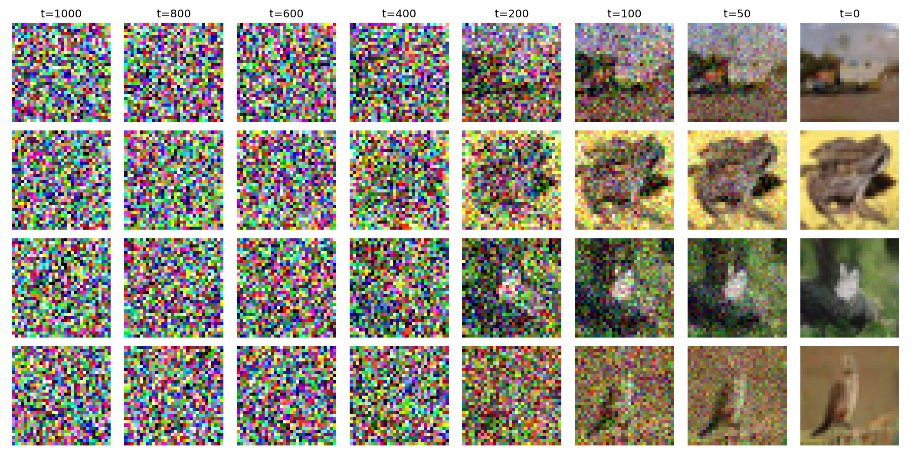
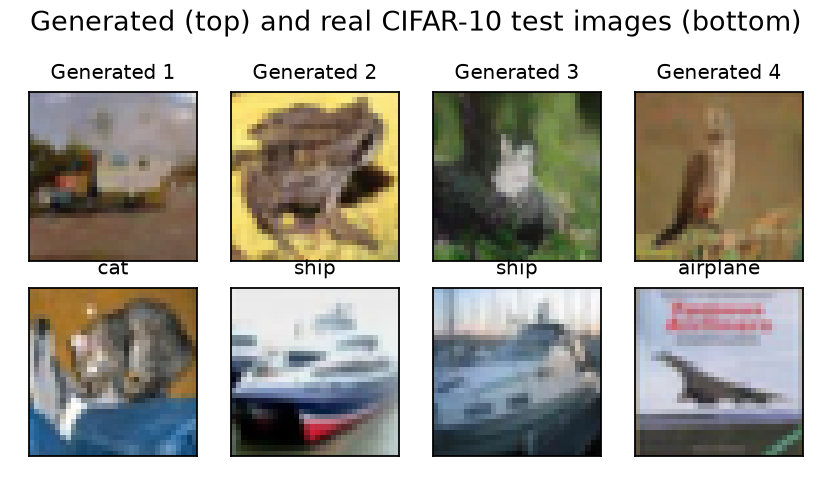

`scripts/images.py`按配置实现 JAX U-Net：128/256/256/256通道、GroupNorm、SiLU、残差块、16×16与中间4×4 attention、下采样、最近邻上采样与跳跃拼接。
读取原始safetensors，卷积权重从OIHW转成HWIO，旧attention参数名映射到参考实现的新名。
时间嵌入使用该检查点的 `flip_sin_to_cos=false`、`freq_shift=1`；每次数学层级t传为模型索引t−1。
内部卷积为NHWC，网络输入输出为B×3×32×32，全部float32。

参考为 [Diffusers v0.40.0](https://github.com/huggingface/diffusers/tree/v0.40.0)。
验证在模型索引0、49、499、999用相同输入分别运行PyTorch参考和JAX实现；最大绝对差1.0014×10⁻⁵，最大相对RMS约7.19×10⁻⁷。
详见 [unet_verification.json](evidence/unet_verification.json)。PyTorch只用于独立对照，实际照片生成与补全均在JAX CPU运行。

生成固定4张图片，种子7200，完整1000步；复用Part 1的线性β、方差β、末步不加噪，采样状态和干净估计都不裁剪。
显示时才映射(x+1)/2并裁剪到[0,1]。原始末态最大值约1.01886，保存此值也证明未把采样状态裁成[-1,1]。
本机采样与绘图约54秒，详见 [photographs.json](evidence/photographs.json)。

前几列基本是彩色噪声；t=200时出现大致色块，t=100到50时物体轮廓逐渐清楚。
最终第一张类似道路上的车辆，第二张像青蛙，第三张像树枝旁的鸟，第四张像站立的鸟；32×32分辨率下类别判断有不确定性。
下方真实图库使用Week 6的`cifar()`和`gallery()`，按测试集原顺序取前四张，不按生成图挑选匹配对象。
真实图片有更明确的物体和背景关系；生成图片也形成类似照片的颜色与形状，但细节模糊，并不保证每张都对应清晰类别。

下载前学到的是噪声预测器的权重，即不同噪声层下的图像规律。现在程序计算的是固定权重的前向预测、反向均值和高斯抽样；没有再训练网络。
该模型无类别条件、无文本输入。照片不是恢复某张原图，而是从新噪声生成样本。

图库复现依赖Week 6已下载的`../week6/inputs/cifar10/cifar-10-binary.tar.gz`。
如果缺失，可先执行Week 6 README中的数据下载命令；数据源为
https://mindspore-website.obs.cn-north-4.myhuaweicloud.com/notebook/datasets/cifar-10-binary.tar.gz 。

## Part 5：RePaint 补全

```sh
mkdir -p inputs
curl -fL https://giggleliu.github.io/AMAT5315-2026Fall/downloads/week7-images.npz \
  -o inputs/images.npz
uv run --locked python scripts/images.py inpaint
```

最后一条命令生成下图及MSE表。

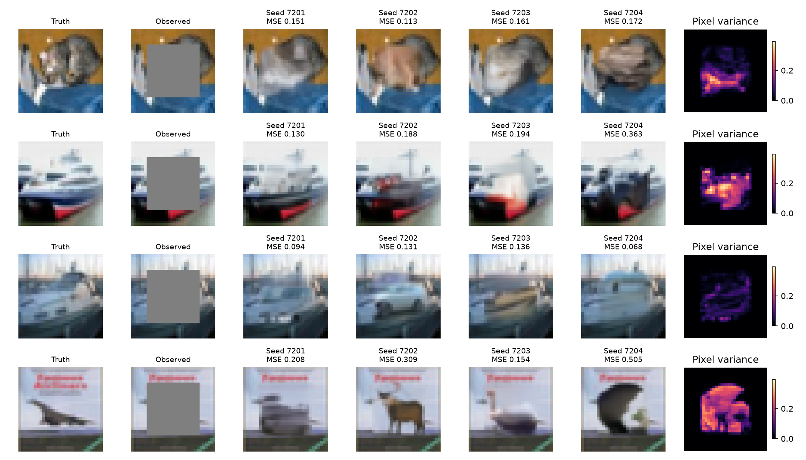

输入NPZ中使用`test`的四张图片，`validation`没有用于选择参数或结果。
遮住全部通道的行列6:26（Python右端不含26），每图1200个隐藏值；未观察位置先置0。
`repaint()`只接收observations和mask，不接收隐藏真值；真值仅在采样结束后计算MSE与展示。

层级1000、980、…、20、0；前49个跳步各尝试两次，末跳只尝试一次，共99次网络评估。
重试前先将合并状态重新向前加噪。每次用讲义式22–23的后验均值和方差提案，并以同层级加噪后的观测覆盖可见像素。
这里仅Tweedie干净估计裁剪至[-1,1]，噪声状态不裁剪；不能用Part 3的跳步方差1−a替代RePaint后验方差。
末层ᾱ₀=1，观测不再含噪声，所以每个可见像素都被精确恢复。

| 种子 | 图1（猫） | 图2（船） | 图3（船） | 图4（飞机） |
|---|---:|---:|---:|---:|
| 7201 | 0.15129 | 0.12957 | 0.09425 | 0.20751 |
| 7202 | 0.11335 | 0.18805 | 0.13102 | 0.30867 |
| 7203 | 0.16113 | 0.19411 | 0.13624 | 0.15401 |
| 7204 | 0.17221 | 0.36266 | 0.06766 | 0.50505 |

这是原始[-1,1]颜色尺度的隐藏区域MSE，未用显示图或[0,1]尺度重新计算。
16张补全平均MSE **0.19230**；最大可见像素变化 **0**，洞外方差 **0**，洞内平均方差 **0.08595**。
方差图对4个种子取总体方差（ddof=0），再对RGB取均值，各行共用色标范围。
统计见 [inpainting.json](evidence/inpainting.json)，原始补全、观测、mask和方差保存在`artifacts/inpainting.npz`。

猫的中心脸部、船的船舱与船体，以及飞机所在的中央区域变化明显；洞外边缘始终相同。
船的不同补全能接上外侧背景，但可能改变船舱颜色和结构；飞机图某些补全甚至变成与原物体不同的形状。
合理补全只要求与观察内容相容，隐藏真值不是唯一可能，因此看似合理仍可有很大MSE。
高方差表示不同补全意见不一致，不等于与真值误差一定高；反过来低方差也不能证明正确。

## 最终核验与完整复现

```sh
uv sync --locked
export JAX_PLATFORMS=cpu
export MPLCONFIGDIR=artifacts/mpl
uv run --locked python scripts/mixture.py train-noise
uv run --locked python scripts/mixture.py part1
uv run --locked python scripts/mixture.py part2
uv run --locked python scripts/mixture.py train-flow
uv run --locked python scripts/mixture.py part3
# 先执行Part 4与Part 5中的下载命令，并准备Week 6的CIFAR-10数据。
uv run --locked python scripts/images.py verify
uv run --locked python scripts/images.py generate
uv run --locked python scripts/images.py inpaint
uv run --locked python scripts/verify.py
```

最后一条命令执行11项测试，生成 [verification.json](evidence/verification.json) 和 [run_settings.json](evidence/run_settings.json)。
验证包括独立高斯条件公式、无偏能量距离、末步不加噪、完整预算与已保存实验结果；RePaint与独立NumPy实现逐步公式对照。
U-Net与官方参考的实际数值对照由 `images.py verify` 完成，测试再检查其记录。
本次11项均通过；这不表示DDIM已达到Part 2的参考宽度范围，该差异单列保留。

环境由`uv.lock`固定；实际版本、CPU后端、模型与输入SHA-256、11张图/动画的SHA-256均记录在verification中。
所有训练与评估随机种子见run_settings和两个training JSON；相同平台可按命令复现，硬件和底层库变化可能产生浮点差异。
下载的权重保持固定，没有权重更新操作；模型权重、原始训练检查点、输入图片和大数组保存在本地被忽略目录。

按五个任务分别提交源码、环境与证据。本次完成五个必做部分，不做bonus。
[模拟指挥记录](DIRECTION_LOG.md)按学生口吻组织任务指令，并明确标注为角色模拟；不冒充真实逐字对话。
讲义要求Week 8开始展示，本README可直接作为展示材料；本周没有另行提交入口，也未声称完成课堂展示。
