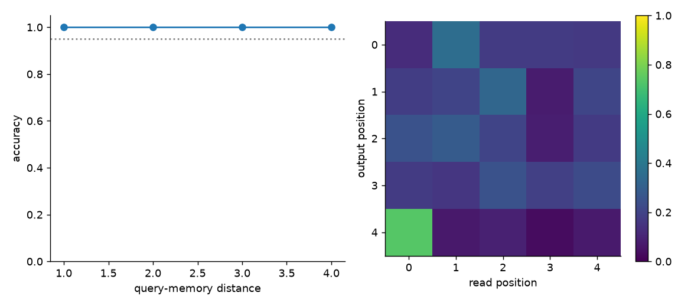
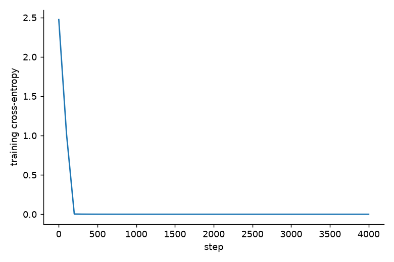

# Week 8：语言模型与 Transformer

本周六个必做部分均已执行；不做 Part 3、Part 5 的 Extension（按 bonus 排除）。**完成实验不等于所有参考阈值通过**：计数模型参考表与指定分词器的结果有差异，外积容量斜率也略超容差，详见下文及 `evidence/verification.json`。

讲义：[week8-learning-sheet.pdf](week8-learning-sheet.pdf)，来自 https://giggleliu.github.io/AMAT5315-2026Fall/pdfs/week8-learning-sheet.pdf 。原文保存在 `week8-learning-sheet.txt`，未修改要求。第 12 页字符缺字；根据第 15 页 Figure 12 与用户核对后，Part 4 使用“算”。

所有命令从 `week8/` 执行。使用 uv、Python 3.12、JAX CPU；模型 float32，NumPy 统计与记忆实验 float64。安装与下载：

```sh
../week5/.bootstrap/bin/uv sync --locked
sh scripts/download.sh
uv run --locked python scripts/prepare.py
```

若 PATH 中没有 uv，后续 `uv` 替换为 `../week5/.bootstrap/bin/uv`。下载脚本固定讲义要求的 revisions。`data/`、`artifacts/`、`.venv/` 被 Git 忽略；源码、锁文件、讲义、图和小型 JSON 证据入 Git。`artifacts/` 留有计数表、模型权重、生成 token、bootstrap 参数、原始记忆测量和日志。

## 本周要求与展示清单

| 部分 | 必做工作 | 核心验收 |
|---|---|---|
| 1 | 读取固定预训练词向量；三组九对词；seed 1730 打乱对照 | 训练余弦≥0.3，对照在±0.15 |
| 2 | TinyStories 按故事 90/10；512 BPE；uniform 与 1–6 gram | 归一化、采样卡方、泛化与维度灾难 |
| 3 | 外积、最小二乘、ReLU¹²³；三维度、全部 M、三次独立实验；训练 MLP | 容量标度；MLP 与 bigram 相差<0.01 nats |
| 4 | 32×32“算”字；四种记忆；新键值对的注意力召回 | softmax R<0.1；每距离准确率>95% |
| 5 | 两层 decoder；6000 步；四类采样器 | 胜过计数模型、使用长上下文、采样与熵一致性 |
| 6 | 240 条 Chinchilla 数据拟合；81 起点；400 bootstrap | 参数、残差、最优算力分配 |

讲义要求每项任务提交 Git，推送源码与证据；Week 9 开始时展示，无另外提交入口。本仓库结果可以用于展示，但不代表已经在课堂展示。模拟学生指令见 [DIRECTION_LOG.md](DIRECTION_LOG.md)，不是实际逐字对话。

## Part 1：词向量中的几何关系

命令：`uv run --locked python scripts/embeddings.py`。


下载 `minishlab/potion-base-8M@bf8b056` 的 safetensors 与 tokenizer，不使用 PyTorch。表为 29528×256；指定词直接对应 token 行。先归一化每行，再求 b−a；每对与另外八对平均偏移算余弦，避免把自己包含在参考方向里。箭头长度为 1，横坐标即余弦；上方是训练表，下方是打乱表。

| 关系 | 训练表均值 | 打乱表均值 |
|---|---:|---:|
| country-capital | 0.46587 | 0.02947 |
| male-female | 0.54852 | -0.01480 |
| comparative | 0.43300 | 0.00877 |

全部通过。随机打乱保留向量集合及几何距离，却破坏词与向量的对应，因此是语义解释的关键对照。

## Part 2：计数语言模型

命令：`uv run --locked python scripts/counts.py`。


语料下载地址：
https://huggingface.co/datasets/roneneldan/TinyStories/resolve/f54c09fd23315a6f9c86f9dc80f725de7d8f9c64/TinyStoriesV2-GPT4-valid.txt

分词器：`karpathy/tinyllamas@0bd21da/stories260K/tok512.model`，使用 SentencePiece。按 `<|endoftext|>` 分割、strip、去空，前 24867 故事训练、后 2763 验证。串联每篇编码及 EOS，第一项预测前用 EOS 初始化；每个预测 token 都计入损失。分母字符数为 strip 后原始故事字符数总和，不把人工 EOS 标记算作文字。

训练 9,667,035 tokens；验证 1,078,996 tokens、2,213,915 字符，即 2.051829 字符/token。验证集恰有 3 篇因空白规范化不能完全往返。训练集往返差异为 71 篇。

平滑 k 在 {0.0001,0.001,0.01,0.1,1} 中，用训练 token 的最后 10% 选择，选择阶段仅对前 90% 计数；随后用完整训练集重估计数，最后才评价验证集。用 uint64 编码稀疏 n-gram，未出现的上下文严格给均匀概率，没有额外回退到低阶模型。

| 模型 | k | nats/token | perplexity | bits/字符 | 未见 n-gram |
|---|---:|---:|---:|---:|---:|
| uniform | — | 6.23832 | 512.000 | 4.38633 | — |
| 1 | 0.0001 | 4.83940 | 126.394 | 3.40271 | 0.000% |
| 2 | 0.01 | 3.03819 | 20.867 | 2.13623 | 0.027% |
| 3 | 0.01 | 2.09434 | 8.120 | 1.47259 | 0.633% |
| 4 | 0.01 | 1.86275 | 6.441 | 1.30975 | 4.151% |
| 5 | 0.01 | 2.08253 | 8.025 | 1.46429 | 12.225% |
| 6 | 0.001 | 2.55040 | 12.812 | 1.79325 | 23.499% |

显式枚举长度 1、2、3 的全部 512、512²、512³ 条路径，最大归一化误差 3.22e-15。生成 250000 个 bigram token，取训练集中最常见的 20 个前词，稀有期望计数合并后汇总卡方：p=0.37642。均通过。

**参考数值差异：**讲义同时要求约 2.05 字符/token 和均匀模型 3.747 bits/字符，但 512 类均匀模型的交叉熵恰为 9 bits/token，9/2.05≈4.39。因此这两条无法同时满足。指定下载文件、故事划分与分词器均按原要求执行；本次 unigram/bigram/trigram 的 nats、perplexity 及部分 unseen 比例也与参考表不同，不能声称复现该表。未修改 tokenizer、字符分母、语料或随机种子去追参考数值。这个内部矛盾不单独解释表中所有差异，具体参考运行仍需课程方确认。

4-gram 最优，5、6-gram 变差的结论保持。注意“未见 n-gram”不等于“未见上下文”：前者的分子只有 k，后者整个分布才是均匀。增大 n 使可能上下文数达到 512^(n−1)，数据很快不足以可靠估计每行。

## Part 3：固定权重中的记忆

命令：`uv run --locked python scripts/memory.py capacity`。


d=16、32、64，M=16 至 65536 的全部 2 的幂；每组 3 次独立随机 unit keys/values。每次查询**全部存储键**，按 512 查询分块，未用抽样查询代替。先平均每个 query 的 R，再平均三次实验；原始三次结果保留。最小二乘使用伪逆，其自身信号系数是投影矩阵对角元 h_j；计算其他项相对 h_j v_j 的比例，不能把简单预测残差误当 R。

容量按 log M–log R 穿过 R=1 的相邻点插值。理论外积约 d、最小二乘约 2d、ReLU^p 约 2d^p/(2p−1)!!。

| store | d=16 容量 | d=32 | d=64 | 容量对 d 的斜率 |
|---|---:|---:|---:|---:|
| outer | 19.34 | 33.33 | 66.68 | 0.89276 |
| least squares | 32.00 | 64.00 | 128.00 | 1.00000 |
| ReLU | 35.89 | 63.92 | 130.34 | 0.93036 |
| ReLU² | 215.79 | 748.40 | 2849.88 | 1.86160 |
| ReLU³ | 786.31 | 5308.03 | 39126.95 | 2.81846 |

最小二乘在 M≤d 的最大 R 为 1.47e-13。外积与最小二乘在 d=64 的容量均通过范围；ReLU 各次幂的斜率均通过。**外积斜率 0.89276 比 0.9 下限略低，未通过这条严格容差**；三次随机抽样不足以把小维度容量稳定到该精度是可能原因，本次未追加抽样或挑种子修饰结果。

命令：`uv run --locked python scripts/neural.py mlp`。


网络 512×64 embedding →512 tanh→512 logits；4000 AdamW 步、batch 16384、峰值 lr=0.006。未规定的细节显式设为：warmup 200、cosine 至峰值 10%、weight decay 0.01。训练批中的重复前词合并成 512×512 计数权重，数学上与原始 16384 样本目标和梯度相同，独立测试已对照；没有把随机 minibatch 改成全数据最优化。

MLP 验证损失 3.043273，实际 bigram 3.038192，差 0.005082<0.01，通过相对验收；与讲义绝对参考 3.152 的差异沿用 Part 2。两者仅看前一个 token，MLP 用共享权重近似存储对应条件概率。有限数据下泛化还取决于平滑和正则化，因此‘只看一个 token’不意味着任意计数估计器都是绝对最优。

## Part 4：由上下文即时建立的记忆

命令：`uv run --locked python scripts/memory.py pictures`。


32×32 的“算”（STHeiti Medium 字体）阈值化为 ±1；其他图随机 ±1，key 为 64 维随机单位向量。softmax β=8。显示前除以目标自身权重；正像素以面积表示，负值不画墨点，统计使用完整浮点值，不用显示裁剪值。图为预定首个 draw，20 次独立 draw 的中位数用于比较参考统计。

| M | 外积 R | ReLU R | ReLU² R | softmax R |
|---|---:|---:|---:|---:|
| 64 | 0.96823 | 0.69737 | 0.14198 | 0.00655 |
| 256 | 2.01687 | 1.39211 | 0.28710 | 0.01339 |
| 1024 | 3.98391 | 2.79503 | 0.58403 | 0.02767 |
| 4096 | 7.99483 | 5.71249 | 1.22347 | 0.05689 |

所有图像召回目标通过。M=4096 时 ReLU² 的干扰大于信号，而 softmax 仍清晰。归一化权重不会改变干扰/信号比；指数权重使匹配键相对其他键更突出。

命令：`uv run --locked python scripts/neural.py recall`。




8 keys、8 values；每序列四个不重复 key，其 value 新随机生成，末尾查询某个已存 key。64 维、单头 Q/K/V/O、1/√64 缩放、残差、LayerNorm、8 类 readout；无位置编码。4000 AdamW 步、batch 256、lr=0.003；warmup 200、cosine 至 0.0003、weight decay 0.01。独立 seed 1904 的 20000 个测试序列，在距离 1、2、3、4 上准确率全部为 1.000。图中 query 主要读第一个 memory，该键值对每次重新产生，因此不能靠训练权重硬记目标。

## Part 5：Transformer 与采样

训练命令：`uv run --locked python scripts/neural.py transformer`。


2 层、宽度 96、4 heads、context 64；learned token/position embedding，pre-norm attention+residual，pre-norm GELU MLP（4d）+residual，末尾 LN 和 readout，所有线性映射有 bias。6000 AdamW 步、32×65 token 随机窗口、每窗口 64 个 next-token 目标；lr=0.003、300 warmup、cosine 至 0.0003、weight decay 0.01。共训练 12,288,000 个预测位置。

评估与生成命令：`uv run --locked python scripts/generate.py`。


模型共 328,832 参数，训练约 102.6 秒。验证 1.729719 nats/token、**1.216211 bits/字符**，优于所有计数模型，也低于讲义的 1.315 阈值。按不重叠 64-token 目标窗口评价全体验证 token（首个输入 EOS）；尾窗补齐值只用于计算，不计入总体损失。位置曲线舍去尾部不完整窗口，阴影为窗口间 2 SE，不是逐 token 独立性假设。最后 8 个位置平均损失 1.66229，第 32 位置起全部低于实际 trigram 损失。
同一个 seed 1848，各模型温度 1，按 bits/字符从差到好列出 60-token 开头。仅这个展示实验排除 EOS 并重新归一化，与讲义参考样例一致；其他统计采样保留 EOS。由于分布不同，相同随机种子不意味着 token 相同。

**Uniform**

```text
R for>Ǫ�5 c
�06myithMgch�b� bew�ge� Ho> so)�P�� playrF�d##Z”�ntt She mޕ8 namedz
```

**Unigram**

```text
spd to. Lilyingilhe aed time a gededae.ur playu ee he Heououked  cAd the epingotey b goundndcc w go hea had withid to ss p
```

**Bigram**

```text
Lily, there was very mad she a som we worited with it. Mick. She said. She flealan's the pris plag wat bared. re with elewing unt and anor
```

**Trigram**

```text
 R for>Ǫ�5 c
�06myithMgch�b� bew�ge� Ho> so)�P�� playr��d##Z”�ntt She made a toy c
```

**Transformer**

```text
Towy and Max in a tree who could go. He was very good at slow and jealous. Max did not know Tim and Max looked up a
```

故事可形成词句，但本次小模型会产生 Towy 等名字、语义不顺与人物混淆；低损失不保证故事正确、连贯或有常识。四种指定 sampler 的 128-token 结果如下，均使用 seed 1848，没有挑选样例。

**temperature，设置 {'temperature': 0.8}**

```text
Lucy had a pretty create blue things. She wanted to to find anyone, so she picked it up and she saw a man chased the sky. Sue learned being brave and we can find my broken." Lily agreed.
Suddenly, the scary monster had many toys. The girl li
```

**top_k，设置 {'temperature': 0.8, 'top_k': 20}**

```text
Lucy thought about a fun toy. She saw a big red ball with a ball. The village was very smart and wanted to help. She did not know what to do.
In the dragon, Lucy left, there was a big red ant named Emmma. Amy liked to play with her ball. She liked to play in the yarn. The pr
```

**top_p，设置 {'temperature': 0.8, 'top_p': 0.9}**

```text
Lily lived a little girl named Sue. She was always very curious. Lily was very happy and enough to go outside to play.
One day, her mother saw a little boy named Tim. Tim wanted to climb the rock and his mom brother. He smiled as folding the stick and he learned that sometimes, even when he also li
```

**min_p，设置 {'temperature': 0.7, 'min_p': 0.1}**

```text
One day, a little boy named Tim went to the park. He saw a big red ball. The ball was scared. He wanted to play with the ball and his friends. Tim was very happy.
Tim's friend, Sam, saw a big ball. Sam said, "Why are you sad, Tim?" Sam said, "Yes, you can't play with me." Sam was sad and said, "Yes, Sam! What is
```

固定上下文 `The little`，每种 sampler 独立抽 100000 个 next token；低于 5 的期望计数合并。最初的 `Once upon a time` 使 top-p/min-p 仅保留一个 token，卡方自由度为 0，因此改为多分支上下文后再做检验，没有根据 p 值挑上下文或种子。

| sampler | χ² p 值 |
|---|---:|
| temperature | 0.442544 |
| top_k | 0.762415 |
| top_p | 0.169914 |
| min_p | 0.988569 |
温度 0.0001 的 100000 次抽样全为 argmax。top-p 必须保留使累积概率首次跨阈值的 token，已用独立手算分布测试。

每种温度生成 128 个独立随机序列、每序列 128 tokens；都用温度 1 模型打分，以每个序列的平均 surprise−entropy 计算 SE：

| 采样温度 | 平均 surprise | 预测 entropy | z |
|---|---:|---:|---:|
| 1.0 | 1.670956 | 1.663213 | 0.764 |
| 0.7 | 1.098812 | 1.541030 | -69.593 |

两条均通过：T=1 与自身概率一致；低温偏向高概率 token，使 surprise 明显低于原模型熵。温度、top-k、top-p、min-p 都是在改变生成分布，并非继续训练模型。

## Part 6：Chinchilla 缩放律

命令：`uv run --locked python scripts/scaling.py`。


固定数据地址：
https://raw.githubusercontent.com/epoch-research/analyzing-chinchilla/92258837425e1b5f2851d624287f0120583a3d0e/data/svg_extracted_data.csv

245 条，剔除 loss 最高 5 条，240 条拟合；D=C/(6N)。对 log L 的残差使用 δ=0.001 Huber，正参数 E/A/B 用对数参数化；L-BFGS-B 多起点网格 A={100,500,2000}、B={100,1000,5000}、α/β={0.2,0.35,0.5}，E 起点 1.8，共 81 组。宽边界仅防数值溢出，最优点位于内部。目标及梯度同除 δ 改善停止判据，不改变最小值。400 次有放回 bootstrap 从最佳参数启动，400 次全部收敛。

| 参数 | 拟合值 | bootstrap 标准误 |
|---|---:|---:|
| E | 1.817218 | 0.024977 |
| A | 477.825864 | 114.376365 |
| B | 2143.417291 | 1426.267350 |
| alpha | 0.347310 | 0.014502 |
| beta | 0.367172 | 0.020853 |

拟合平均 log 残差 -0.0006564；原论文打印参数残差 0.0167419，对应系统性高估约 1.7%。所有缩放律目标通过。

固定 C 下，N*=G(C/6)^(β/(α+β))、D*=(C/6)/N*，G=(αA/(βB))^(1/(α+β))。C=5.76×10²³ FLOP 时，N*=73.19B，D*=1.312T，**D*/N*=17.92**；95% bootstrap 区间 [7.50, 33.56]，包含 20。打印参数则给 92.6 tokens/parameter。完整 10¹⁸–10²⁵ 算力网格的 N*/D* 保存在 JSON 和图中。注意这是该训练设定的经验最优，不包含部署推理成本，也不表示所有模型都应固定用 20。

## 知识要点

1. **语言模型为何容易归一化：**链式法则把序列概率拆成有限词表上的条件概率，每一步都能精确归一化；祖先采样逐步生成对应分布。
2. **分词与评价单位：**token 不等于字符或单词。交叉熵用 nats/token；perplexity=exp(loss)；bits/字符必须使用实际总负 log 概率除以实际字符数，不能只换一个标签。
3. **统计学习的限制：**H(q,p)=H(q)+KL(q‖p)。更丰富的上下文可减少模型偏差，但稀疏计数的估计误差会增长，出现维度灾难；平滑给没见过的事件非零概率。
4. **两类记忆：**MLP 把长期规律写进固定权重；attention 把当前文本的 key/value 临时写成记忆。后者才能读取本次故事刚给出的新信息。
5. **非线性减少串扰：**线性存储容量约 d，ReLU^p 约 d^p，指数权重可更强地压制不匹配项；softmax 只统一缩放，不改变串扰比。
6. **Transformer 的分工：**Q/K 决定读谁，V 决定读什么；多个 head 提供多个读法。因果 mask 防止看未来，位置向量区分顺序，残差与 LayerNorm 帮助稳定优化。
7. **训练和生成是两件事：**训练最小化 next-token 交叉熵；采样温度和截断修改生成分布。低温更确定，并不必然更真实或更有意义。
8. **计算预算是一项权衡：**固定 C≈6ND，模型过大则数据不足，过小则表示能力不足。缩放律拟合与 bootstrap 分别给出最优方案和不确定性；发表的参数也需要用数据复核。

## 核验与完整复现

```sh
uv sync --locked
sh scripts/download.sh
uv run --locked python scripts/prepare.py
uv run --locked python scripts/embeddings.py
uv run --locked python scripts/counts.py
uv run --locked python scripts/memory.py capacity
uv run --locked python scripts/neural.py mlp
uv run --locked python scripts/memory.py pictures
uv run --locked python scripts/neural.py recall
uv run --locked python scripts/neural.py transformer
uv run --locked python scripts/generate.py
uv run --locked python scripts/scaling.py
uv run --locked python scripts/verify.py
uv run --locked python scripts/write_report.py
```

`verify.py` 运行 6 个独立公式/实现测试：手算 n-gram、NumPy attention 与排列不变性、因果性、MLP 批合并梯度、采样阈值、缩放律梯度与最优点。另逐条审计保存的实验目标，**允许如实记录参考目标未通过，不把它们伪装成测试全通过**。本次 6 项实现测试通过；参考目标差异见 `evidence/verification.json` 的 `failed_targets`。

依赖版本及全部输入、讲义和证据图的 SHA-256 保存于该核验文件。主要 seed：embedding shuffle 1730、bigram 1802、MLP 1803、attention 1804（测试 1904）、Transformer 1805、memory 1830、pictures 1840、scaling 1806、展示样例 1848、采样检验 1855、熵一致性 1856。随机种子固定，硬件/底层库浮点差异仍可能影响训练结果。图片生成依赖 macOS 的 STHeiti 字体；其他平台需提供同一字体才能逐像素重现。
