# Week 8: Language models and the transformer

Exercises follow the October 28 revision of [the handout](week8-learning-sheet.pdf). The two extensions are excluded. The separate synthetic recall training exercise is no longer required; its earlier outputs are retained only in ignored local artifacts.

## Reproduction

Run commands from `week8/`. Use Python 3.12, uv and CPU JAX. Replace `uv` with `../week5/.bootstrap/bin/uv` if it is not on PATH.

```sh
uv sync --locked
sh scripts/download.sh
uv run --locked python scripts/prepare.py
```

Corpus: https://huggingface.co/datasets/roneneldan/TinyStories/resolve/f54c09fd23315a6f9c86f9dc80f725de7d8f9c64/TinyStoriesV2-GPT4-valid.txt

The download script also pins the embedding table, tokenizer and Chinchilla data to the handout revisions. Downloads, model checkpoints and raw arrays stay in ignored `data/` and `artifacts/`. Versions, input/figure SHA-256 hashes and target checks are recorded in [verification.json](evidence/verification.json); raw settings are in `artifacts/run_settings.json`.

## 1. Embeddings

```sh
uv run --locked python scripts/embeddings.py
```

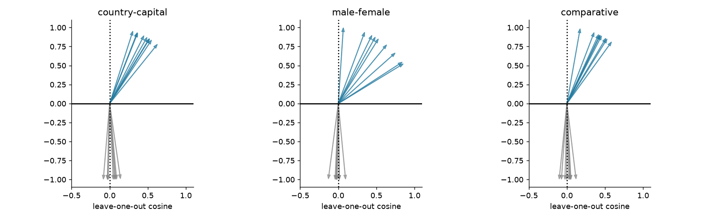

Load the 29528 x 256 safetensors table without PyTorch. Normalize rows before subtracting each specified word pair. Compare each offset with the mean of the other eight offsets, excluding itself. The shuffled control uses seed 1730. Each unit arrow's horizontal coordinate is its leave-one-out cosine. Shuffling preserves the vectors but destroys their association with words. Numerical results: [embeddings.json](evidence/embeddings.json).

## 2. Count models

```sh
uv run --locked python scripts/counts.py
```

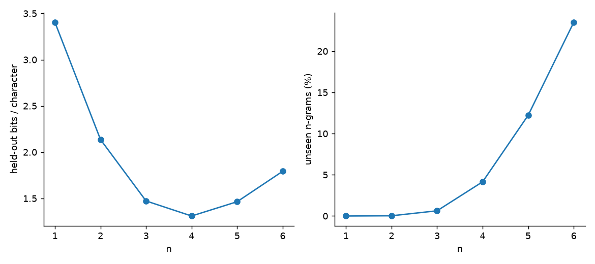

Split stripped, nonempty stories in file order: 24867 training and 2763 validation stories. SentencePiece uses the prescribed 512-token BPE model, with EOS between stories. Validation has 1078996 tokens and 2213915 original characters (2.05183 characters/token); three stories fail exact round-trip because of whitespace normalization.

Choose add-k smoothing on the last 10% of training tokens using counts from the first 90%, then refit counts on all training tokens. Never tune on validation. Score all tokens, including EOS, but do not count synthetic EOS markers as text characters. Sparse uint64 n-gram keys avoid allocating dense high-order tables. Unseen contexts receive the uniform distribution; no backoff model is added.

Explicitly enumerate all sequences of lengths 1, 2 and 3 for normalization. Generate 250000 bigram tokens and pool chi-squared statistics over the 20 most frequent training tokens, combining rare bins. An unseen n-gram and an unseen context are different: only the latter makes the entire next-token distribution uniform.

## 3. Memory capacity and MLP

```sh
uv run --locked python scripts/memory.py capacity
```

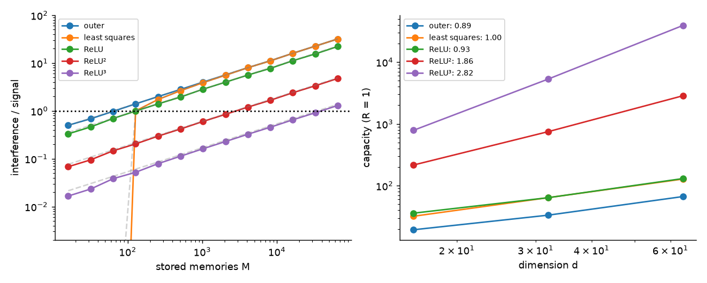

For d=16,32,64 and M=8,16,...,65536, query every stored key. Compute mean per-query interference/signal within a draw, then take the median over three independent draws. Interpolate the R=1 crossing on log-log axes. Chunking queries limits memory without subsampling. Least-squares recall uses the projection diagonal as its own-signal coefficient. Full draws: `artifacts/memory_progress.npz`.

```sh
uv run --locked python scripts/neural.py mlp
```

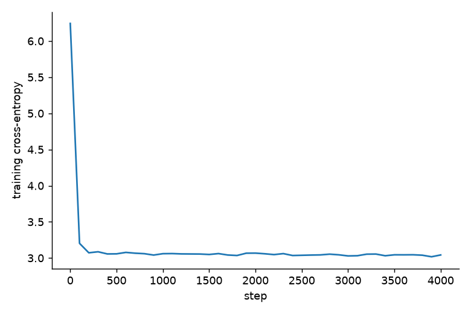

Embedding width 64, 512 tanh hidden units, 512 logits. Train 4000 AdamW steps with 16384 examples, peak learning rate 0.006, 200 warmup steps, cosine decay to 10%, weight decay 0.01. Repeated previous-token inputs in each sampled batch are aggregated into a weighted loss; an independent test checks that both loss and gradient equal the unaggregated batch objective. The model sees one previous token, so comparison with the bigram measures how well its weights approximate that conditional table.

## 4. Picture recall

```sh
uv run --locked python scripts/memory.py pictures
```

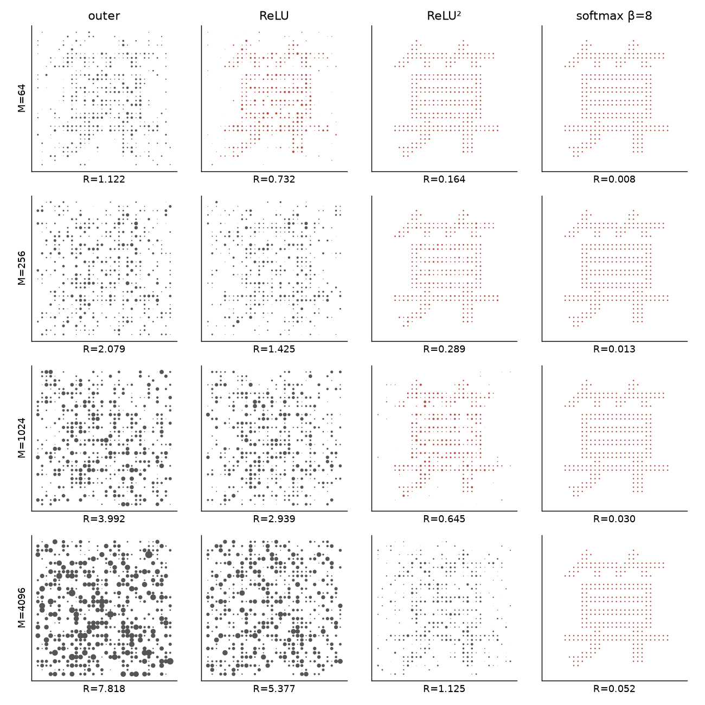

Use the prescribed U+7B97 glyph, rendered to 32 x 32 with STHeiti Medium, ink +1 and background -1. Other values are random +/-1 images; keys are random unit vectors in d=64. Compare outer-product, ReLU, squared ReLU and softmax at beta=8. Divide the recalled image by its own memory weight. Dot area shows positive pixel magnitude; R uses the full, unclipped array. The figure shows the first preselected draw; statistics include the median of 20 draws.

Exponential weighting strongly favors the matching key. Softmax normalization rescales signal and interference equally, so it does not change their ratio. Exact pixel reproduction requires the same macOS font.

## 5. Transformer and generation

```sh
uv run --locked python scripts/neural.py transformer
```

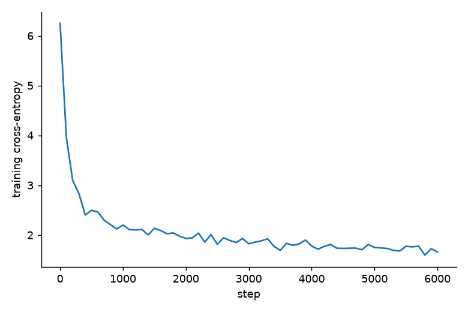

Two pre-norm layers, width 96, four heads, context 64, learned token/position embeddings, causal attention, 4d GELU MLPs, residual connections, final layer norm and readout. Every linear map has a bias. Train 6000 AdamW steps, batch 32, learning rate 0.003, 300 warmup steps and cosine decay to 0.0003; weight decay is 0.01. Each 65-token training sample supplies 64 targets.

Evaluate consecutive 64-input-token windows starting at the first held-out token. The first token is conditioning information, so 1078995 subsequent tokens are scored; padded targets are excluded. Bits per character uses the original validation character count. Count-model scores additionally include the initial token conditioned on EOS. Position curves use complete windows; shading is two standard errors across windows.

```sh
uv run --locked python scripts/generate.py
```

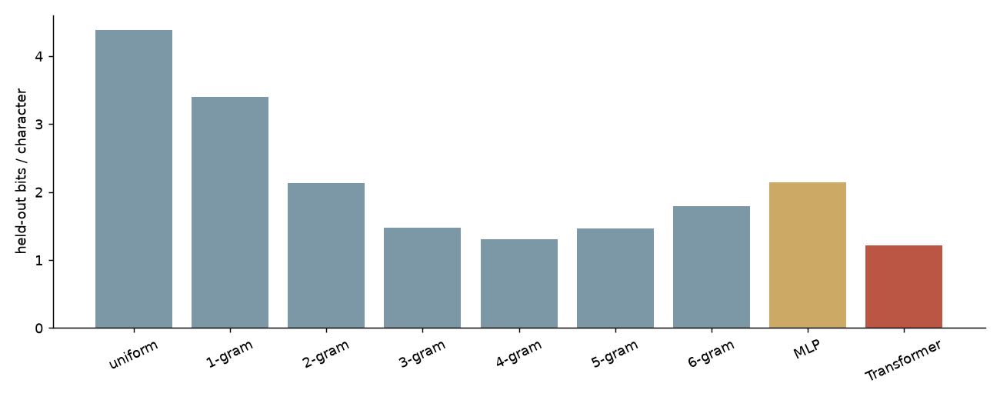
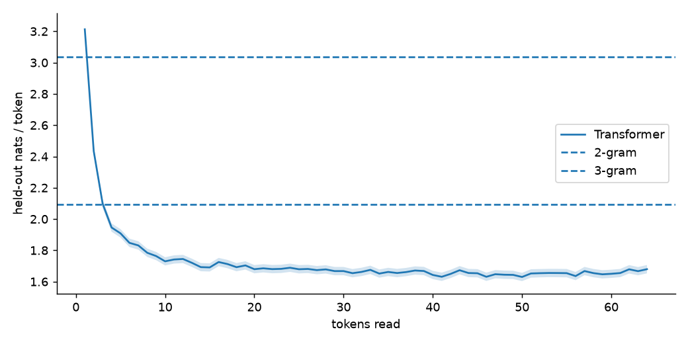

Temperature rescales logits. Top-k keeps k candidates; top-p includes the token crossing the cumulative threshold; min-p retains probabilities above a fraction of the maximum. Renormalize after truncation. Test 100000 draws per sampler from the broad fixed context `The little`; also test temperature 0.0001. Generate 128 independent 128-token sequences at temperatures 1 and 0.7. Score both with the temperature-1 model and calculate the surprise-minus-entropy z-score over sequences, not individual correlated tokens.

All displayed examples use seed 1848. The 60-token comparison excludes EOS, matching the handout's example convention; statistical generation retains EOS. Full sampler settings, 128-token examples and statistics: [generation.json](evidence/generation.json).

## 6. Scaling law

```sh
uv run --locked python scripts/scaling.py
```

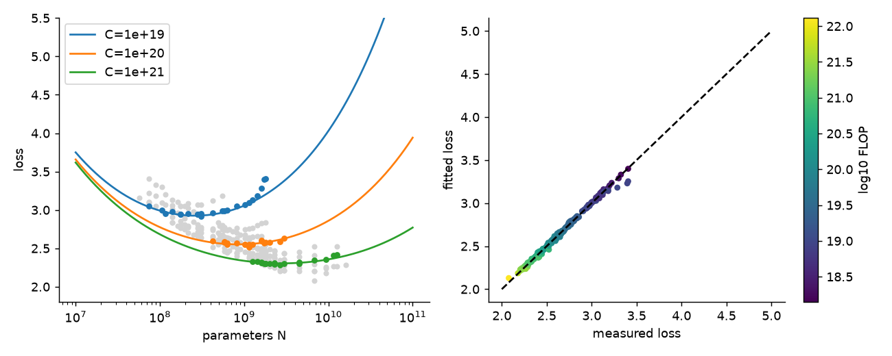
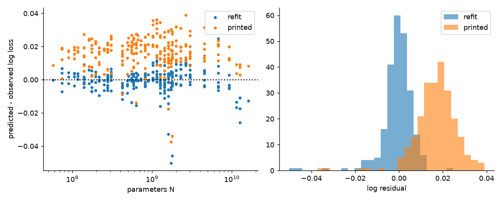
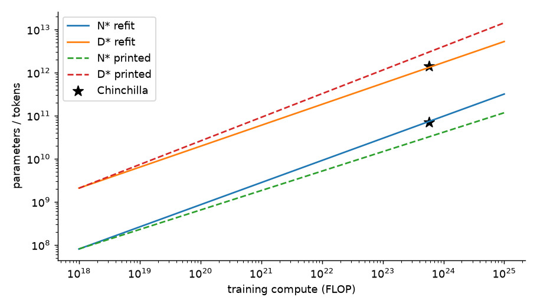

Use the prescribed CSV revision. Remove the five highest-loss runs, leaving 240; compute D=C/(6N). Fit L=E+A/N^alpha+B/D^beta using Huber loss on log residuals, delta=0.001. L-BFGS-B starts at 81 combinations: A={100,500,2000}, B={100,1000,5000}, alpha/beta={0.2,0.35,0.5}, E=1.8. E,A,B are parameterized logarithmically. Dividing loss and gradient by delta improves stopping criteria without changing the optimum.

Refit 400 bootstrap resamples from the best fit. Residuals are predicted minus measured log loss. At fixed C, N*=G(C/6)^(beta/(alpha+beta)), D*=C/(6N*), G=(alpha A/(beta B))^(1/(alpha+beta)). Compute-optimal allocations for 1e18 through 1e25 FLOP, parameter standard errors and the tokens-per-parameter interval are saved in [scaling.json](evidence/scaling.json).

## Verification

```sh
uv run --locked python scripts/verify.py
```

Seven independent tests check hand-counted n-grams, NumPy attention and permutation invariance, causal masking, batch-gradient equivalence, sampling thresholds, memory signal/capacity interpolation, and scaling gradients/optima. Handout target checks are recorded separately from implementation tests. Seeds: 1730 (shuffle), 1802 (bigram), 1803 (MLP), 1805 (transformer), 1830 (memory), 1840 (pictures), 1806 (bootstrap), 1848 (examples), 1855 (sampler tests), 1856 (entropy consistency).

Present the evidence at the start of Week 9. No separate submission is required.

## Measured results

| Model | Nats/token | Perplexity | Bits/character |
|---|---:|---:|---:|
| uniform | 6.238325 | 512.0000 | 4.386331 |
| 1-gram | 4.839400 | 126.3935 | 3.402710 |
| 2-gram | 3.038192 | 20.8675 | 2.136233 |
| 3-gram | 2.094340 | 8.1201 | 1.472586 |
| 4-gram | 1.862755 | 6.4415 | 1.309752 |
| 5-gram | 2.082535 | 8.0248 | 1.464285 |
| 6-gram | 2.550397 | 12.8122 | 1.793252 |
| MLP | 3.043273 | 20.9738 | 2.139806 |
| Transformer | 1.729609 | 5.6385 | 1.216133 |

The 4-gram is the best count model. The transformer beats it. MLP minus bigram loss is 0.005082 nats/token.

| Memory store | Capacity d=16 | d=32 | d=64 | Fitted slope |
|---|---:|---:|---:|---:|
| outer | 19.98 | 33.09 | 65.17 | 0.85303 |
| least squares | 32.12 | 64.00 | 128.00 | 0.99733 |
| ReLU | 35.29 | 66.82 | 136.56 | 0.97601 |
| ReLU² | 213.21 | 732.49 | 2836.79 | 1.86697 |
| ReLU³ | 763.62 | 5292.47 | 39191.25 | 2.84077 |

The outer-product slope (0.85303) falls outside the handout's [0.9,1.1] target. This target is not met. The seed remains 1830; the complete revised M grid and median-of-three protocol were used, without selecting favorable draws. Finite-sample variation is a possible explanation, not proof that the target passed. Other capacity slopes pass.

Scaling fit: E=1.817218, A=477.826, B=2143.417, alpha=0.347310, beta=0.367172. At C=5.76e23 FLOP, D*/N*=17.921, 95% bootstrap interval [7.501, 33.565]. All 400 bootstrap fits converged.

Generation consistency z-scores: T=1: 0.764; T=0.7: -69.593. All four sampler chi-squared p-values exceed 0.001.

### Matched-seed, temperature-1 openings

Listed from highest to lowest bits per character. Each opening has 60 sampled tokens.

**Uniform**

```text
R for>Ǫ�5 c
�06myithMgch�b� bew�ge� Ho> so)�P�� playrF�d##Z”�ntt She mޕ8 namedz
```

**Unigram**

```text
spd to. Lilyingilhe aed time a gededae.ur playu ee he Heououked  cAd the epingotey b goundndcc w go hea had withid to ss p
```

**Bigram**

```text
Lily, there was very mad she a som we worited with it. Mick. She said. She flealan's the pris plag wat bared. re with elewing unt and anor
```

**Trigram**

```text
 R for>Ǫ�5 c
�06myithMgch�b� bew�ge� Ho> so)�P�� playr��d##Z”�ntt She made a toy c
```

**Transformer**

```text
Towy and Max in a tree who could go. He was very good at slow and jealous. Max did not know Tim and Max looked up a
```
