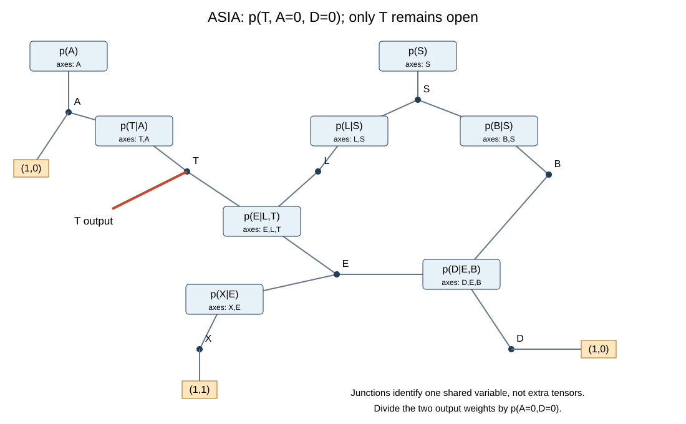
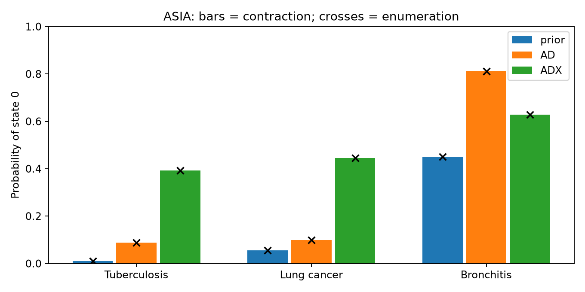
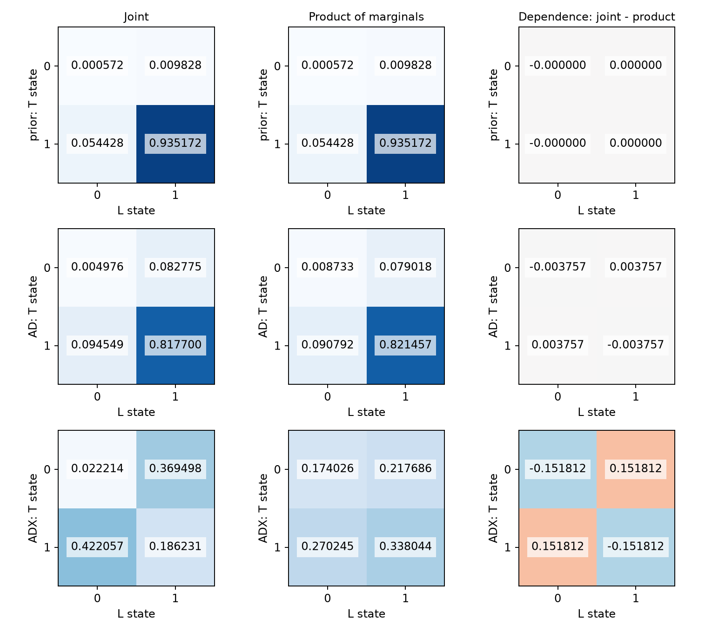
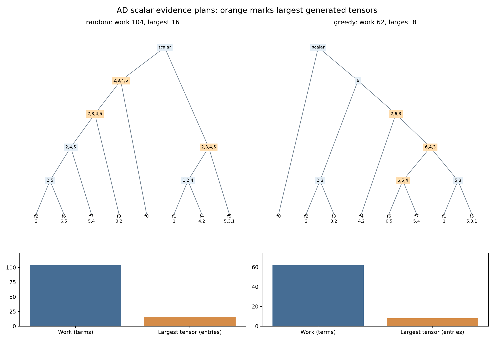
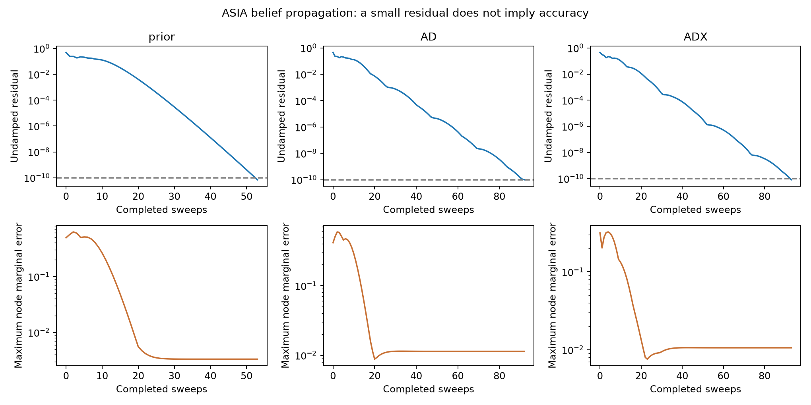
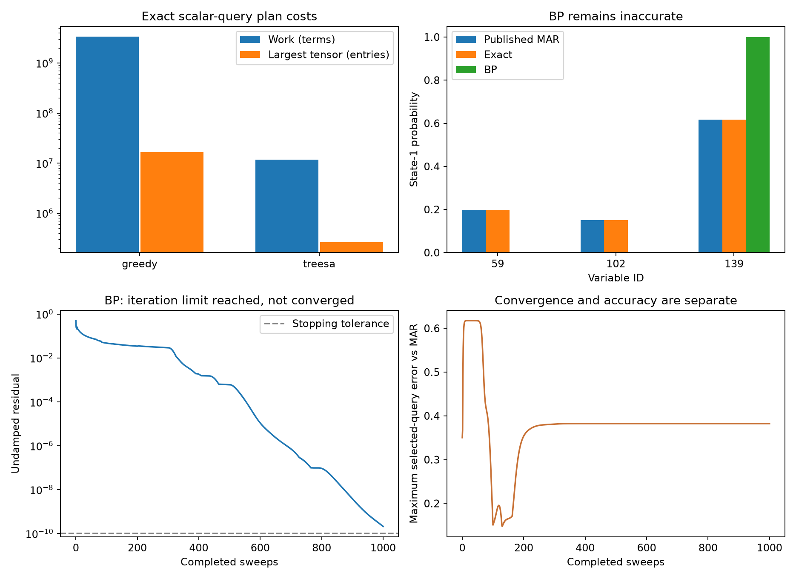

# Week 9: Probabilistic inference by tensor contraction

The [current handout](week9-learning-sheet.pdf) was downloaded from the course website on November 4, 2026. This folder contains the four hands-on builds and their verification evidence. Tutorial questions and sketches are not deliverables.

## Environment and reproduction

Rust 1.96.0; f64 arithmetic; tenferro-tensor, tenferro-cpu and tenferro-einsum 0.7.1; omeco 0.2.6. Tensor contraction uses the CPU backend with no GPU or autodiff features enabled. Python is used for independent checks and plots. Cargo.lock and uv.lock pin dependencies.

From this folder:

```sh
rustup toolchain install 1.96.0 --profile minimal
cargo +1.96.0 fetch --locked
uv sync --locked --python 3.12
# Optional: refresh public source files.
sh scripts/download.sh
sh scripts/run.sh
```

Use `../week5/.bootstrap/bin/uv` if uv is not on PATH. The run script installs the executable inside the ignored `bin/` directory, runs every experiment, redraws the figures, and verifies the results. It sets `RAYON_NUM_THREADS=2`. The original benchmark timings also used two CPU threads; they are single measurements, not averaged timing benchmarks. BP itself is a serial Rust implementation.

To verify the checked-in evidence without rerunning experiments:

```sh
.venv/bin/python scripts/verify.py
```

The verifier runs seven Rust tests, independently parses ASIA in NumPy, recounts saved plans, checks PR/MAR, checks all saved BP beliefs, and records source hashes and versions in [verification.json](evidence/verification.json). Full BP histories are saved as compressed JSON in `evidence/`; temporary expanded runs live in ignored `artifacts/`.

## 1. Exact ASIA inference

The executable follows [infer.design.toml](infer.design.toml). All original UAI tables remain unchanged. UAI lists axes in scope order with the last axis varying fastest. Reversing both the shape and labels maps the same buffer to tenferro's column-major representation. Direct enumeration uses the original UAI order independently.

```sh
infer --model asia.uai --evidence prior --out artifacts/prior
infer --model asia.uai --evidence AD --out artifacts/AD
infer --model asia.uai --evidence ADX --out artifacts/ADX
```

Here `infer` denotes the installed executable, or `./bin/bin/infer`. State 0 means yes/present/positive. AD fixes A=0,D=0; ADX additionally fixes X=0. Observations are sliced into every affected factor, retaining resulting scalars. Observed node marginals are restored as point masses.



The diagram displays the original eight factors, with their UAI axes, shared-variable junctions, observation caps, and the sole open T index. It is algebraically equivalent to the sliced computation. The X all-ones cap sums an unobserved leaf. S is shared by three factors.

| Case | Evidence mass | P(T=0) | P(L=0) | P(B=0) |
|---|---:|---:|---:|---:|
| prior | 1 | 0.010400 | 0.055000 | 0.450000 |
| AD | 0.004501375 | 0.087751 | 0.099525 | 0.811402 |
| ADX | 0.00098822675 | 0.391712 | 0.444271 | 0.628822 |




Adding a positive X-ray raises T and L probabilities and lowers B. For ADX, P(T=0,L=0)=0.022214 while P(T=0)P(L=0)=0.174026. The negative joint-minus-product difference is dependence, not an implementation error. If T is confirmed under ADX, the joint gives P(L=0|T=0,ADX)=0.056709, below 0.444271: tuberculosis explains much of the X-ray evidence.

All node and joint marginals normalize. Contraction/enumeration marginal errors are below 1e-10 and relative mass errors below 1e-10. [Full precision results](evidence/asia.json) and [independent NumPy checks](evidence/numpy_checks.json) are retained. The T,A table is explicitly tested as `[[0.05,0.01],[0.95,0.99]]`.

The same executable checks AB=[[4,4],[10,8]], tr(AB)=12, and the three-spin Ising ring at beta=0.5,J=1. The ring contraction gives 12.602562098951932, within 3.6e-15 of explicit enumeration. NumPy direct matrix sums match exactly. The checks use tolerance 1e-12.

## 2. Contraction orders

```sh
infer --model asia.uai --evidence AD --order random --seed 42 --out runs/random
infer --model asia.uai --evidence AD --order greedy --out runs/greedy
infer --model asia.uai --evidence AD --analyze runs/random/order.json --out runs/analysis
infer --model asia.uai --evidence AD --plan runs/greedy/order.json --out runs/replay
```

Random uses rand 0.9 StdRng with seed 42. Greedy uses omeco GreedyMethod. Plan files include dimensions, input scopes, evidence, tree, output labels, method, seed and planning time. Replay validates the network signature and all intermediate axes. Analyze only walks the tree and computes costs; it does not perform inference or run numerical checks.



| AD scalar plan | Work (terms) | Largest tensor (entries) |
|---|---:|---:|
| random | 104 | 16 |
| greedy | 62 | 8 |

The random plan's largest generated tensor retains S,L,B,E (IDs 2,3,4,5), with 16 entries. The greedy plan has three equally large generated tensors, retaining X,E,B; X,B,L; and S,X,L, each with 8 entries. The 8-entry E,L,T input is also included in the space count. Orange boxes mark largest generated tensors in the figure.

Work sums the product of dimensions over each pair's union of labels. Space includes every input and intermediate, including scalar factors. Omeco may retain a locally unused index until a later step; those retained axes and their costs are saved as actually executed. Evidence slicing and tie-breaking can produce plans different from the handout's reference. Neither heuristic certifies optimality. [Independent Python recounts](evidence/order_checks.json) verify each step and the totals. Replay gives the same mass within 1e-10 relative tolerance.

## 3. Belief propagation

```sh
infer --model asia.uai --evidence ADX --method bp \
  --damping 0.5 --tolerance 1e-10 --max-sweeps 1000 --out artifacts/bp-ADX
```

Repeat for prior and AD. Messages start uniformly. Both message directions read the previous state in a synchronous update, exclude the recipient's incoming message, and normalize every proposal. Damping retains half the old message and half the proposal. A zero normalizer stops with an error.

At state m, the recorded residual is max|F(m)-m|, and beliefs use the incoming factor messages at that same state. The returned state is checked again. The residual is never replaced by the damped step size. Sweep 0 is the initial state.



| Case | Completed sweeps | Final residual | Maximum node error |
|---|---:|---:|---:|
| prior | 53 | 7.03e-11 | 0.003340 |
| AD | 92 | 9.94e-11 | 0.011407 |
| ADX | 93 | 8.23e-11 | 0.010612 |

All three runs meet the residual tolerance, but none has exact marginals. A separate nonuniform factor-tree test matches enumeration. Another test uses extremely small damping to ensure a small step cannot falsely claim convergence. [Summary](evidence/bp_summary.json); full traces: [prior](evidence/bp-prior.json.gz), [AD](evidence/bp-AD.json.gz), [ADX](evidence/bp-ADX.json.gz).

Update work counts scalar multiplications and additions in message proposals, including initial and final residual evaluations. Normalization, belief calculation and damping are excluded. This convention is recorded in each run.

## 4. Promedus_14 benchmark

The unchanged MARKOV model has 414 binary variables. Its evidence file fixes nine variables. Only IDs 59,102,139 are requested from exact inference; BP computes all node beliefs.

```sh
infer --model promedus/Promedus_14.uai --evidence promedus/Promedus_14.uai.evid \
  --queries 59,102,139 --order greedy --out runs/promedus-greedy
RAYON_NUM_THREADS=2 infer --model promedus/Promedus_14.uai \
  --evidence promedus/Promedus_14.uai.evid --queries 59,102,139 \
  --order treesa --seed 42 --out runs/promedus-treesa
infer --model promedus/Promedus_14.uai --evidence promedus/Promedus_14.uai.evid \
  --method bp --damping 0.5 --tolerance 1e-10 --max-sweeps 1000 \
  --out artifacts/promedus-bp
```

TreeSA uses time-only weights (1,0,0), two trials, 100 beta levels `0.01+0.15*i` for i=1,...,100, 20 iterations per level, and greedy initialization. Omeco 0.2.6 internally seeds SmallRng with trial_index+42, so the supported seed is 42 and trial seeds are 42 and 43. Saved settings include the full schedule. Hash-map tie-breaking can affect a fresh greedy initialization; replay saved plans to reproduce the recorded costs exactly.

Selected queries reuse the scalar tree topology and recompute retained axes for the requested open variable. Each query's complete plan and cost file is saved separately. These query runs are not charged only the scalar-plan cost.

Every intermediate is divided by its maximum positive entry; the removed log scale is accumulated, including scales from scalar evidence factors. The final sum restores those logarithms. This gives log10 Z_evidence, not an evidence probability. A nonbinary hyperedge test verifies scope order, reversed query order, retained scalars, and a tenfold weight rescaling: log10 Z increases by one while normalized marginals remain unchanged.

| Method | Scalar work | Largest tensor | Planning (s) | Scalar contraction (s) | Complete run (s) |
|---|---:|---:|---:|---:|---:|
| greedy | 3,368,805,881 | 16,777,216 | 0.0172 | 0.2050 | 0.7461 |
| TreeSA | 11,770,528 | 262,144 | 0.1452 | 0.0102 | 0.2273 |

TreeSA reduces this pair of plans' work by 286.2 times and largest tensor by 64 times. These are measured plan-cost ratios, not runtime speedups or optimality claims. Costs differ from the handout reference. Exact plans agree within 3.6e-15 in log10 Z and better than 1e-10 in selected marginals.

Both give log10 Z_evidence=-7.80674630458243. Error against the rounded published PR is 3.70e-6 (tolerance 1e-4); maximum selected marginal error against rounded MAR is 4.32e-7 (tolerance 1e-5).

| Variable | Exact P(state=1) | BP P(state=1) |
|---|---:|---:|
| 59 | 0.1975882582 | 0.0000856180 |
| 102 | 0.1497534323 | 0.0002507605 |
| 139 | 0.6175220184 | 0.9998749358 |



BP reaches 1000 sweeps with residual 2.1163e-10, above 1e-10: **unconverged**. Maximum selected-query error is 0.382353: **inaccurate**. Runtime is 0.1942 s and message-proposal update work is 22,446,424 operations. BP computes all 414 node beliefs, whereas exact inference here queries only three variables; costs should be interpreted with that difference in scope. [Numerical comparisons](evidence/promedus.json), [complete BP trace](evidence/promedus-bp.json.gz), and [saved plans](runs/) are retained.

## Sources and presentation requirement

- [Course handout](https://giggleliu.github.io/AMAT5315-2026Fall/pdfs/week9-learning-sheet.pdf), downloaded November 4, 2026; its SHA-256 is in verification.json.
- [ASIA source](https://raw.githubusercontent.com/TensorBFS/TensorInference.jl/935ed86f8e473f523cac9461c45a1f470e74f0f9/examples/asia-network/model.uai), pinned TensorInference.jl revision 935ed86f8e473f523cac9461c45a1f470e74f0f9.
- [UAI 2014 mirror](https://github.com/mroavi/uai-2014-inference-competition/tree/22005844423f5bca62798548df808cc418fc0d7d/uai2014), pinned revision 22005844423f5bca62798548df808cc418fc0d7d. Model, evidence and PR are from PR/; MAR is from MAR/.
- [tenferro-rs](https://github.com/tensor4all/tenferro-rs), [omeco](https://docs.rs/omeco/0.2.6/omeco/).

Page 15 asks for these hands-on results at the **start of Week 10**, a README with reproduction details, and a push of implementation and evidence. The Week 9 handout does **not** mention a final presentation, final-presentation topic, or final-presentation deadline.
